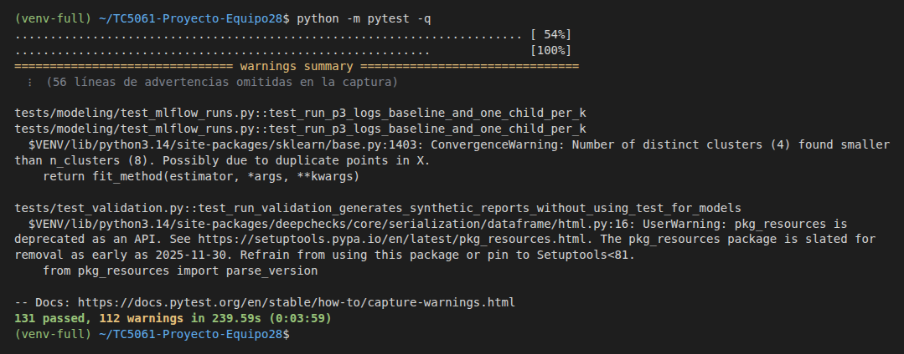
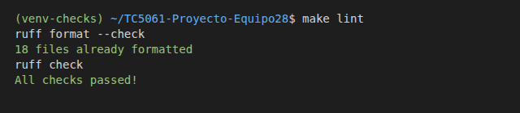
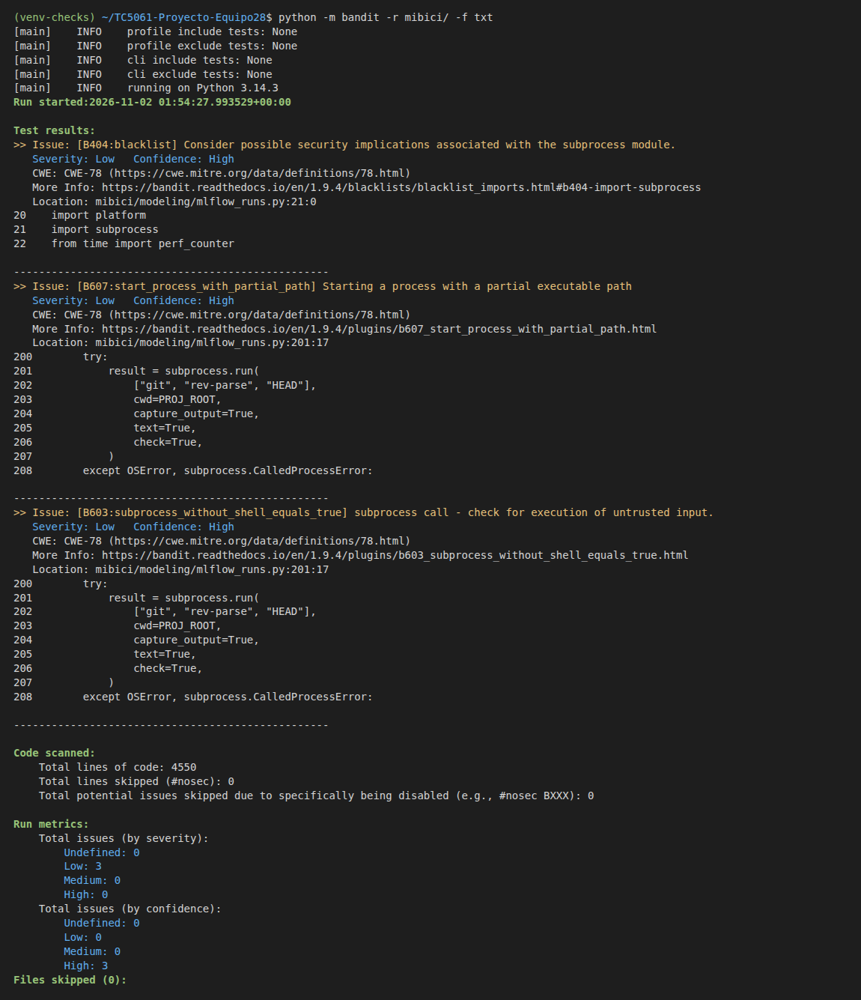
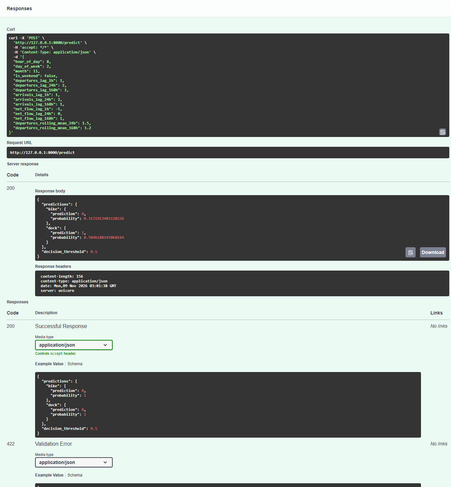

# TC5061-Proyecto-Equipo28

**Proyecto MiBici: propuesta y base reproducible**

Tecnológico de Monterrey | TC5061 — MLOps  
Equipo 28

## 1. Descripción del proyecto

Este proyecto tiene como objetivo desarrollar una solución reproducible de Machine Learning para analizar los patrones de utilización del sistema de bicicletas públicas MiBici del Área Metropolitana de Guadalajara.

La solución contempla modelos de regresión, clasificación y clustering, utilizando los registros históricos de viajes y la información de las estaciones.

El proyecto implementará buenas prácticas de MLOps, incluyendo versionado de código y datos, modularización, seguimiento de experimentos con MLflow y colaboración mediante GitHub.

## 2. Preguntas del proyecto

| ID | Tipo de problema | Objetivo |
|---|---|---|
| P1 | Regresión | Predecir la cantidad de viajes que se iniciarán en una estación o zona durante un periodo futuro. |
| P2 | Clasificación | Estimar el riesgo de que una estación se quede sin bicicletas o sin anclajes disponibles. |
| P3 | Clustering | Identificar grupos de estaciones que presentan patrones de uso similares. |

Para P2 se desarrollará una aproximación del riesgo utilizando los registros de viajes y la capacidad de las estaciones, debido a que los datos abiertos no incluyen inventarios históricos de bicicletas.


## 3. Fuentes de datos

Los datos provienen del portal oficial de [Datos abiertos de MiBici](https://www.mibici.net/es/datos-abiertos/).

### 3.1. Registros históricos de viajes

Se utilizan los doce archivos CSV correspondientes a enero–diciembre de 2025.

| Característica | Valor |
|---|---|
| Periodo | Enero–diciembre de 2025 |
| Archivos originales | 12 CSV |
| Viajes registrados | 4,532,032 |
| Estaciones observadas | 371 |
| Tamaño total aproximado | 393 MB |
| Codificaciones | UTF-8 y Windows-1252 |

Los archivos de referencia son:

- `references/mibici_sources_2025.csv`: manifiesto con las URLs oficiales.
- `references/mibici_inventory_2025.csv`: inventario de archivos, tamaños y huellas SHA-256.

### 3.2. Catálogo de estaciones

Se utiliza el archivo `nomenclatura_2026_09.csv`, correspondiente a septiembre de 2026, con 484 estaciones.

Este catálogo es posterior al periodo analizado. Por tanto, no se asume que todas sus estaciones o capacidades estuvieran vigentes durante 2025.

### 3.3. Privacidad y almacenamiento

Durante la estandarización se excluyen los campos `Usuario_Id`, `Genero` y `Año_de_nacimiento`.

Los archivos originales, intermedios y procesados se almacenan localmente y no se incluyen en Git.

### 3.4. Limitaciones de los datos

Los registros de viajes no contienen inventarios históricos de bicicletas ni disponibilidad real de anclajes.

Por ello, el problema P2 utilizará indicadores proxy basados en los flujos de salidas y llegadas, sin afirmar que representan estados reales de estaciones vacías o llenas.

Asimismo, las horas sin viajes no garantizan que una estación estuviera operativa.

## 4. Estructura del repositorio

```text
TC5061-Proyecto-Equipo28/
├── data/                 # Datos originales, intermedios y procesados
├── docs/                 # Reporte de la segunda entrega (resultados, selección y evidencias)
├── mibici/               # Código fuente del proyecto
│   ├── clustering.py     # Agrupamiento de estaciones (P3)
│   ├── config.py         # Configuración centralizada
│   ├── dataset.py        # Ingesta y preparación de datos
│   ├── features.py       # Ingeniería de características
│   ├── tracking.py       # Registro del pipeline de datos en MLflow
│   ├── validation.py     # Integridad y drift de P1/P2 con Deepchecks
│   ├── workflow.py       # Encadena los entry points bajo un run padre
│   ├── api/              # Servicio REST P2 y exportación de modelos
│   └── modeling/         # Modelos P1 y P2, runs de MLflow, búsqueda y Model Registry
├── models/               # Modelos generados localmente
├── notebooks/            # Exploración de datos
├── references/           # Manifiestos de datos, handoff P1/P2 y auditoría del catálogo
├── reports/
│   └── figures/          # Figuras y visualizaciones
├── tests/                # Pruebas (misma estructura que mibici/)
│   ├── conftest.py       # Fixtures compartidas (tracking store temporal de MLflow)
│   ├── factories.py      # Datos sintéticos reutilizados por varias pruebas
│   ├── test_*.py         # Pruebas de mibici/*.py (dataset, features, clustering, tracking, validation)
│   └── modeling/         # Pruebas de mibici/modeling/*.py
├── .gitignore            # Exclusiones de Git
├── Makefile              # Atajos para los entry points de MLflow
├── MLproject             # Entry points de MLflow Projects
├── pyproject.toml        # Configuración del paquete
├── python_env.yaml       # Entorno de MLflow Projects
├── requirements.txt      # Dependencias directas
└── requirements-lock.txt # Versiones del entorno
```

## 5. Entorno de desarrollo

El proyecto se ha inicializado utilizando:

- Python 3.14.4.
- WSL Ubuntu.
- Visual Studio Code.
- Cookiecutter Data Science.
- Git y GitHub.
- pandas, NumPy, scikit-learn y PyArrow.
- MLflow para seguimiento de experimentos.
- pytest y Ruff para pruebas y calidad del código.

Las dependencias se mantienen con versiones fijadas para facilitar la reproducción del entorno.

## 6. Instalación

Clonar el repositorio:

```bash
git clone <URL_DEL_REPOSITORIO>
cd TC5061-Proyecto-Equipo28
```

Crear y activar el entorno virtual:

```bash
python3.14 -m venv .venv
source .venv/bin/activate
```

Instalar las dependencias:

```bash
python -m pip install -r requirements.txt
```

Verificar la instalación:

```bash
python -m pip check
```

La integración de validación usa el extra `validation` de `mibici` (Deepchecks 0.19.1 y setuptools 80.10.2, requerido por `pkg_resources` en esta versión de Deepchecks). Ya está incluido en `requirements.txt`; para instalarlo por separado en un entorno existente:

```bash
python -m pip install -e ".[validation]"
```

## 7. Ejecución con MLflow Projects

El archivo `MLproject` define los entry points que MLflow puede ejecutar y `python_env.yaml` fija las versiones de Python y librerías.

### 7.1. Preparar la terminal

En cada terminal nueva, activa el ambiente de la sección 6 y elige el experimento:

```bash
source .venv/bin/activate
export MLFLOW_EXPERIMENT_NAME=mibici-equipo28   # si no, los runs caen en "Default"
export MLFLOW_TRACKING_URI=http://127.0.0.1:5000 # servidor de la sección 7.2
```

En Windows (PowerShell) usa `$env:NOMBRE="valor"` y define también `$env:PYTHONUTF8=1`: sin él, `mlflow run` falla con `UnicodeEncodeError` si rediriges la salida a un archivo o la canalizas.

### 7.2. Levantar el servidor de tracking

El Model Registry necesita un backend con base de datos. En una terminal aparte, con el ambiente activado, levanta el servidor de MLflow con un backend sqlite:

```bash
mlflow server --backend-store-uri sqlite:///mlflow.db --artifacts-destination ./mlartifacts --host 127.0.0.1 --port 5000
```

También puedes usar `make mlflow-server`. Deja esa terminal abierta mientras trabajas: los runs, los modelos registrados y sus artefactos se guardan en `mlflow.db` y `mlartifacts/`, y la UI queda disponible en http://127.0.0.1:5000.

Con `MLFLOW_TRACKING_URI` definido (sección 7.1), todos los comandos `mlflow run` y `make mlflow-*` registran en ese servidor. Si no lo defines, MLflow usa `mlflow.db` local directamente.

### 7.3. Correr el proyecto

```bash
mlflow run . -e ingest --env-manager local
```

MLflow lee el archivo `MLproject`, toma el entry point `ingest` y ejecuta
`python -m mibici.dataset run-pipeline`, es decir, el pipeline completo de la sección 8.4.
La opción `--env-manager local` usa el ambiente activado en lugar de crear uno nuevo.
Al final debe decir `=== Run (ID '...') succeeded ===`.

Requiere conexión a Internet para descargar los archivos que aún no estén disponibles localmente.

`ingest` acepta los parámetros `year` y `manifest_path`, cuyos valores por defecto (`2025` y `references/mibici_sources_2025.csv`) vienen de `INGEST_YEAR` y `SOURCES_MANIFEST` en `mibici/config.py`:

```bash
mlflow run . -e ingest -P year=2025 -P manifest_path=references/mibici_sources_2025.csv --env-manager local
```

### 7.4. Entry points disponibles

| Entry point | Comando | Con `make` | Qué hace |
|---|---|---|---|
| `ingest` | `mlflow run . -e ingest --env-manager local` | `make mlflow-ingest` | Ejecuta el pipeline de datos (descarga, preparación y datasets horarios) |
| `p1_train` | `mlflow run . -e p1_train --env-manager local` | `make mlflow-p1` | Entrena y valida los modelos de regresión P1 |
| `p2_catalog` | `mlflow run . -e p2_catalog --env-manager local` | `make mlflow-p2` | Descarga y audita el catálogo de capacidades de estaciones |
| `p2_targets` | `mlflow run . -e p2_targets --env-manager local` | `make mlflow-p2` | Construye las etiquetas proxy de P2 para train y validation |
| `p2_train` | `mlflow run . -e p2_train --env-manager local` | `make mlflow-p2` | Verifica las etiquetas y entrena y valida los clasificadores P2 |
| `p3_train` | `mlflow run . -e p3_train --env-manager local` | `make mlflow-p3` | Agrupa las estaciones por perfil de uso con K-Means y un baseline por cuantiles |
| `train` | `mlflow run . -e train -P question=p1 --env-manager local` | `make mlflow-train QUESTION=p1` | Entrena una pregunta con el modelo e hiperparámetros elegidos (sección 7.5) |
| `search` | `mlflow run . -e search -P question=p1 --env-manager local` | `make mlflow-search QUESTION=p1` | Busca hiperparámetros de P1 o P2: un run padre con los baselines y un hijo por combinación (sección 7.5) |
| `register` | `mlflow run . -e register --env-manager local` | `make mlflow-register` | Registra los mejores modelos en el Model Registry y actualiza el alias `champion` (sección 7.7) |
| `evaluate` | `mlflow run . -e evaluate --env-manager local` | — | Evalúa en test (noviembre-diciembre) los `champion` de P1 y P2 y sus baselines, sin reentrenar; resultados en [reports/test_evaluation.md](reports/test_evaluation.md) |
| `workflow` | `mlflow run . -e workflow --env-manager local` | `make mlflow-workflow` | Encadena `ingest`, los pasos de P1, P2 y P3 y `register` como runs hijos de un run padre |

Cada paso usa los archivos que genera el anterior: P1, P2 y P3 leen el dataset horario de `ingest`, y `p2_train` necesita el catálogo y las etiquetas de `p2_catalog` y `p2_targets`. `p3_train` usa el catálogo para dibujar el mapa de grupos; si no está descargado, omite el mapa. `make mlflow-p2` ejecuta los tres pasos de P2 en orden. `p2_catalog` requiere conexión a Internet.

Los pasos de modelado solo leen datos de enero a octubre de 2025 (train y validation); noviembre y diciembre quedan reservados como test y ningún paso calcula métricas sobre ellos.

Los comandos de `make` ya definen `MLFLOW_EXPERIMENT_NAME=mibici-equipo28`, por lo que no hace falta ese `export` de la sección 7.1; `MLFLOW_TRACKING_URI` sí debe exportarse para usar el servidor.

### 7.5. Entrenar con parámetros

El entry point `train` entrena una pregunta (`question`: `p1`, `p2` o `p3`) y registra sus runs igual que `p1_train`, `p2_train` y `p3_train`. Sus valores por defecto vienen de `HGB_PARAMS` y `P3_MAX_K` en `mibici/config.py`:

| Parámetro | Por defecto | Aplica a | Qué hace |
|---|---|---|---|
| `question` | (obligatorio) | Todas | Pregunta a entrenar: `p1`, `p2` o `p3` |
| `model` | `all` | Todas | Modelo a registrar: `all`, o uno de `dummy_mean`, `seasonal_weekly`, `hist_gradient_boosting_poisson` (P1); `dummy_prior`, `hist_gradient_boosting_balanced` (P2); `baseline_activity_quantiles`, `kmeans` (P3) |
| `learning_rate`, `max_iter`, `max_leaf_nodes`, `min_samples_leaf`, `l2_regularization` | `0.1`, `100`, `31`, `50`, `1.0` | P1 y P2 | Hiperparámetros de HistGradientBoosting |
| `k` | `0` | P3 | Cantidad de grupos seleccionada; `0` la elige por silhouette |
| `max_k` | `8` | P3 | Mayor k evaluado |

```bash
mlflow run . -e train -P question=p1 -P learning_rate=0.05 -P max_iter=200 --env-manager local
mlflow run . -e train -P question=p3 -P k=4 --env-manager local
```

P2 requiere haber corrido antes `p2_catalog` y `p2_targets`.

**Búsqueda de hiperparámetros.** El entry point `search` reutiliza el entrenamiento de P1 o P2 y evalúa cada combinación de `learning_rates` y `max_leaf_nodes` de HistGradientBoosting con la misma partición temporal (entrenamiento de enero a agosto, validation de septiembre y octubre). Sus valores por defecto vienen de `SEARCH_LEARNING_RATES` y `SEARCH_MAX_LEAF_NODES` en `mibici/config.py`:

| Parámetro | Por defecto | Qué hace |
|---|---|---|
| `question` | (obligatorio) | `p1` o `p2` |
| `learning_rates` | `0.05,0.1,0.2` | Valores de `learning_rate`, separados por comas |
| `max_leaf_nodes` | `15,31,63` | Valores de `max_leaf_nodes`, separados por comas |

```bash
mlflow run . -e search -P question=p1 --env-manager local
mlflow run . -e search -P question=p2 -P learning_rates=0.05,0.1 --env-manager local
```

El run padre se llama `P1-search` o `P2-search`. Sus hijos son los baselines y un candidato por combinación (`P1-regression-search-lr0.05-leaf15`; en P2, `P2-bike-pressure-search-lr0.05-leaf15` y su equivalente `dock-pressure`). El padre guarda `reports/selection_summary.json` con el mejor candidato frente al mejor baseline y los tags `selected_run_*`. Como `register` toma el entrenamiento más reciente de cada pregunta, la búsqueda corrida al final define el champion.

### 7.6. Ver los resultados

Con el servidor de la sección 7.2 corriendo, abre http://127.0.0.1:5000. Si no usas el servidor, ejecuta `mlflow ui` y abre la misma dirección. Selecciona el experimento `mibici-equipo28` para revisar los runs, sus parámetros y artefactos.

No hace falta tener la UI abierta mientras corres los runs: puedes abrirla después.

El paso `ingest` registra en su run:

| Tipo | Qué se registra |
|---|---|
| Parámetros | `year` y el nombre del manifiesto de fuentes |
| Tag `data_version` | Huella SHA-256 de los doce CSV originales; cambia solo si cambian los datos de entrada |
| Métricas | Viajes totales y por mes (`trips_month`), indicadores de calidad (`*_count`, `*_pct`), filas de los datasets horarios, estaciones observadas, porcentaje de horas sin actividad y duración del pipeline |
| Artefactos | `reports/raw_inventory.csv`, `reports/quality_by_month.csv` y los dos datasets horarios en `processed/` |

Los pasos `p1_train`, `p2_train` y `p3_train` registran un run padre por problema (`P1-regression`, `P2-classification` y `P3-clustering`) y, dentro de él, un run hijo por modelo:

| Problema | Runs hijos |
|---|---|
| P1 | `P1-regression-dummy-mean`, `P1-regression-seasonal-168h`, `P1-regression-hist-gradient-boosting-poisson` |
| P2 | `P2-bike-pressure-dummy-prior`, `P2-bike-pressure-hist-gradient-boosting-balanced`, `P2-dock-pressure-dummy-prior`, `P2-dock-pressure-hist-gradient-boosting-balanced` |
| P3 | `P3-clustering-baseline-activity-quantiles` y `P3-clustering-kmeans-k2` a `P3-clustering-kmeans-k8`; el tag `selected` marca el k elegido por silhouette |

Cada run hijo registra:

| Tipo | Qué se registra |
|---|---|
| Parámetros | Clase e hiperparámetros del modelo, `random_state`, columnas predictoras, periodos y tamaños de train/validation; en P2, también los umbrales proxy y el umbral de clasificación; en P3, el periodo de datos, el número de estaciones, los indicadores y su transformación |
| Tags | Pregunta, objetivo, equipo, commit de Git, versiones de Python y scikit-learn y `train_validation_data_version` (huella del dataset horario de enero a octubre); en P2, también la versión y el hash del catálogo y el hash de las etiquetas; en P1 y P2, `model_family` y `stage_of_work` (`baseline`, `training` o `search`) |
| Métricas | Prefijo `val_`: `val_mae` y `val_rmse` en P1; `val_average_precision`, `val_precision`, `val_recall`, `val_f1`, prevalencia y celdas de la matriz de confusión en P2. En P3 (sin partición de validación): `silhouette_score`, `davies_bouldin_score`, `calinski_harabasz_score`, tamaño de los grupos e `inertia` |
| Artefactos | Modelo registrado (baselines y candidatos) con su firma y ejemplo de entrada en P1 y P2; en `evaluation/`, el perfil horario real contra predicho en P1; la matriz de confusión y la curva Precision-Recall en P2; y la asignación de estaciones, los perfiles por grupo, la proyección PCA y el mapa de grupos en P3. En P1 y P2 también `manifests/` (procedencia de los datos y manifiestos de fuentes e inventario) y `config/run_config.json` |

El run padre guarda la tabla comparativa de los modelos y un reporte JSON con los parámetros y la procedencia de los datos en `reports/`.

`mlflow.db`, `mlruns/` y `mlartifacts/` se crean solos al correr y están excluidos de Git.

### 7.7. Model Registry y alias `champion`

El entry point `register` publica en el Model Registry un modelo por pregunta (dos en P2, uno por objetivo):

| Modelo registrado | Runs que compara | Métrica de selección |
|---|---|---|
| `mibici-p1-departures` | Hijos del último run `P1-regression` | `val_mae` (menor es mejor) |
| `mibici-p2-bike-pressure` | Hijos `bike_pressure` del último run `P2-classification` | `val_average_precision` (mayor es mejor) |
| `mibici-p2-dock-pressure` | Hijos `dock_pressure` del último run `P2-classification` | `val_average_precision` (mayor es mejor) |
| `mibici-p3-station-clusters` | Hijo con `selected=True` del último run `P3-clustering` | `silhouette_score` (mayor es mejor) |

Para cada modelo, `register` toma el mejor run hijo del entrenamiento más reciente de su pregunta y lo registra como una versión nueva, con tags de la métrica, la versión de datos y el commit. El alias `champion` (el modelo en producción) solo se mueve a esa versión si mejora la métrica del champion actual; si no, la versión queda registrada sin alias. Volver a correr `register` sin entrenar de nuevo no crea versiones duplicadas.

El flujo es: entrenar (`train` o `workflow`), correr `register` y revisar en la pestaña **Models** de la UI qué versión tiene el alias. `workflow` ya ejecuta `register` como último paso.

Para cargar el modelo en producción desde Python:

```python
import mlflow

model = mlflow.pyfunc.load_model("models:/mibici-p1-departures@champion")
```

### 7.8. Validación de datos con Deepchecks

Ejecuta la validación desde la raíz del repositorio:

```bash
python -m mibici.validation --output-dir reports/deepchecks
```

El comando genera `summary.json` y reportes HTML para:

- P1: integridad de train, validation y test, además de drift de train contra validation y contra el test reservado.
- P2: integridad de train y validation, más comparaciones independientes train/validation para `target_bike_pressure` y `target_dock_pressure`.

El test de P1 solo se usa para informar integridad y drift: no se entrena ni selecciona ningún modelo con él. P2 excluye test y cada comparación incluye únicamente sus predictores históricos permitidos y la etiqueta que se está revisando, nunca la otra etiqueta. Los HTML usan un muestreo determinista de hasta 100,000 filas por partición; `summary.json` informa los conteos de filas y nulos calculados sobre los datos completos, incluidos los nulos de las características de rezago. Cada entrada de `reports` identifica las particiones, el tamaño de muestra, los chequeos ejecutados y excluidos, los chequeos que no pasaron con sus detalles y los errores de ejecución. Nulos en claves o etiquetas, infinitos y claves `station_id-hour` duplicadas detienen la ejecución antes de escribir reportes.

La selección de chequeos evita errores conocidos de Deepchecks 0.19.1 con el entorno fijado (pandas 3.0.6, NumPy 2.5.4 y scikit-learn 1.9.1): se excluyen `Outlier Sample Detection` (`quantile(interpolation)`), `Feature Feature Correlation` (`np.NaN`), `Train Test Samples Mix` (`DataFrame.applymap`) y `Multivariate Drift` (incompatibilidad de `__sklearn_tags__`). También se omite `Index Train Test Leakage`, porque `station_id` se repite intencionalmente y no es un índice único de observación. En P1, `New Label Train Test` no aplica a una etiqueta de regresión; en la integridad conjunta de P2 no se designa una de las dos etiquetas como objetivo. Las particiones comparadas sí incluyen `hour` como metadato temporal para ejecutar los chequeos de solapamiento de fechas.

Se pueden sustituir las rutas de entrada y salida:

```bash
python -m mibici.validation --p1-input data/processed/station_hourly_2025_complete.parquet --p2-input data/processed/p2_targets_2025_train_validation.parquet --output-dir reports/deepchecks
```

Si faltan los archivos de entrada, genera el dataset horario de P1 con `mlflow run . -e ingest --env-manager local`. Para P2, ejecuta `mlflow run . -e p2_catalog --env-manager local` y luego `mlflow run . -e p2_targets --env-manager local`; la descarga del catálogo de estaciones requiere conexión a Internet.

#### Evidencia de ejecución local

Validación completa ejecutada el 1 de noviembre de 2026 con los Parquets locales. Se generaron nueve HTML y un resumen JSON; los reportes usaron hasta 100,000 filas por partición. No hubo errores de ejecución en los chequeos seleccionados.


| Reportes | Resultado observado |
|---|---|
| Integridad P1 (train, validation, test) | 9 chequeos por partición, 0 condiciones no aprobadas y 0 errores |
| Integridad P2 (train, validation) | 7 chequeos por partición, 0 condiciones no aprobadas y 0 errores |
| Drift P1 (train/validation y train/test) | 8 chequeos por comparación; `Feature Drift` señaló `month` en ambas. `Label Drift` pasó con KS 0.02 y 0.01, respectivamente |
| Drift P2 (una comparación por etiqueta) | 9 chequeos por comparación; `Feature Drift` señaló `month` en ambas. `Label Drift` pasó con Cramer's V 0.00622 y 0.00634 |

El resumen de datos completos registró 2,137,920 filas train, 537,640 validation y 536,981 test para P1. Para cada etiqueta P2 registró 2,137,182 filas train y 536,904 validation. No se encontraron nulos en claves o etiquetas, infinitos ni claves estación-hora duplicadas. En cada grupo de features `departures`, `arrivals` y `net_flow`, las columnas de rezago de 1h/24h/168h tienen 369/8,856/61,992 nulos en train y 1/24/168 en validation; P1 test también tiene 1/24/168. Las medias móviles P1 de 24h y 168h tienen 8,856/61,992 nulos en train y 24/168 en validation y test. El hallazgo de drift en `month` se reporta para revisión, no se oculta como error de ejecución.

## 8. Pipeline reproducible de ingeniería de datos

El módulo `mibici/dataset.py` implementa la descarga, validación, preparación y agregación de los datos de MiBici 2025.

### 8.1. Descargar los archivos originales

```bash
python -m mibici.dataset download-year
```

Descarga los doce CSV definidos en `references/mibici_sources_2025.csv`. Los archivos existentes se reutilizan sin volver a descargarlos.

### 8.2. Preparar los datos mensuales

```bash
python -m mibici.dataset prepare-year
```

Lee y valida los CSV, reconoce sus codificaciones y genera doce archivos Parquet estandarizados en `data/interim/`.

Se calculan indicadores de calidad para fechas inválidas, duraciones no positivas y viajes superiores a una hora.

### 8.3. Construir los datasets horarios

```bash
python -m mibici.dataset build-hourly
```

Integra los doce meses, valida los identificadores de viaje y agrega las salidas y llegadas por estación y hora.

Genera:

- `data/processed/station_hourly_2025.parquet`: 1,887,819 registros estación-hora con actividad observada.
- `data/processed/station_hourly_2025_complete.parquet`: 3,212,541 registros estación-hora dentro de 2025, incluyendo horas completadas con cero viajes.

Las horas completadas no garantizan que la estación estuviera operativa.

El dataset observado también incluye llegadas de viajes que finalizaron en enero de 2026, mientras que el dataset completado se restringe al calendario 2025.

### 8.4. Ejecutar el pipeline completo

```bash
python -m mibici.dataset run-pipeline
```

Ejecuta las tres etapas anteriores en orden. Requiere conexión a Internet para descargar los archivos que aún no estén disponibles localmente.

### 8.5. Ejecutar pruebas automatizadas

El proyecto utiliza PyTest para verificar el procesamiento de datos, la agregación horaria y el comportamiento de los modelos. Todas las pruebas están en la carpeta `tests/`, organizada igual que el paquete `mibici/`: cada módulo tiene su archivo `test_<módulo>.py`.

```text
tests/
├── conftest.py           # Fixtures compartidas
├── factories.py          # Datos sintéticos compartidos
├── test_clustering.py    # mibici/clustering.py
├── test_dataset.py       # mibici/dataset.py
├── test_features.py      # mibici/features.py
├── test_tracking.py      # mibici/tracking.py
├── test_validation.py    # mibici/validation.py
└── modeling/
    ├── test_evaluate.py      # mibici/modeling/evaluate.py
    ├── test_mlflow_runs.py   # mibici/modeling/mlflow_runs.py
    ├── test_p2_catalog.py    # mibici/modeling/p2_catalog.py
    ├── test_p2_targets.py    # mibici/modeling/p2_targets.py
    ├── test_p2_train.py      # mibici/modeling/p2_train.py
    ├── test_registry.py      # mibici/modeling/registry.py
    └── test_train.py         # mibici/modeling/train.py
```

Para ejecutar todas las pruebas, desde la raíz del repositorio, basta un solo comando (la configuración está en `pyproject.toml`):

```bash
pytest          # o: make test
```

Pytest descubre los archivos `test_*.py` dentro de `tests/` y sus subcarpetas. La suite cubre casos normales y límite para datos, features, modelos, evaluación, etiquetas P2 y los reportes de Deepchecks. Incluye pruebas de reproducibilidad: P1 ajusta el candidato dos veces y compara métricas con tiempos excluidos; P2 verifica la semilla fija y compara exactamente las probabilidades entre ejecuciones.

Para ejecutar solo una parte de la suite:

```bash
pytest tests/test_dataset.py -v      # procesamiento de datos
pytest tests/test_validation.py -v   # reportes de Deepchecks
pytest tests/modeling -v             # modelado (P1, P2, MLflow y Model Registry)
```

Para repetir las pruebas enfocadas de Deepchecks y reproducibilidad:

```bash
pytest tests/test_validation.py tests/modeling/test_train.py::test_candidate_evaluation_is_deterministic_and_ignores_test_by_default tests/modeling/test_p2_train.py::test_train_objective_uses_balanced_weights_and_explicit_seed tests/modeling/test_p2_train.py::test_run_validation_uses_same_rows_and_is_reproducible -v
```

Evidencia local: con la estructura actual de `tests/`, PyTest ejecutó 131 pruebas y todas pasaron; la salida registró 112 advertencias (casi todas de MLflow, scikit-learn y Deepchecks) y 239.59 segundos. La captura muestra el resultado de `python -m pytest -q`; se omite la parte intermedia del resumen de advertencias y la ruta del entorno virtual aparece abreviada como `$VENV`.



El comando enfocado de Deepchecks y reproducibilidad ejecutó 10 pruebas y obtuvo 10 aprobadas, con 1 advertencia, en 15.77 segundos.

### 8.6. Chequeos de calidad y seguridad

Además de las pruebas, el repositorio tiene tres chequeos que se ejecutan desde la raíz del repositorio con el entorno activado:

| Chequeo | Comando | Qué revisa | Detalle y evidencia |
|---|---|---|---|
| Pruebas | `pytest` (o `make test`) | Toda la suite de `tests/` | Sección 8.5 |
| Estilo y lint | `make lint` | Formato (`ruff format --check`) y reglas de Ruff sobre `mibici/` | Esta sección |
| Calidad de datos | `python -m mibici.validation --output-dir reports/deepchecks` | Integridad y drift de P1 y P2 con Deepchecks | Sección 7.8 |
| Seguridad | `python -m bandit -r mibici/ -f txt` | Análisis estático del código Python con Bandit | Sección 13 |

Ruff ya viene en `requirements.txt`. `make lint` solo revisa; si falla por formato, `make format` aplica las correcciones automáticas. Evidencia de una ejecución correcta:



### 8.7. Experimentación

Los modelos de regresión, clasificación y clustering se ejecutan mediante MLflow Projects y se registran en el experimento `mibici-equipo28` (sección 7). La búsqueda de hiperparámetros de P1 y P2 y la selección del mejor modelo están en [docs/entrega2_mlflow.md](docs/entrega2_mlflow.md).

## 9. Flujo de colaboración

El equipo utilizará GitHub Flow.

- `main` será la rama principal protegida.
- Cada integrante desarrollará sus cambios en una rama independiente.
- Los cambios se integrarán mediante Pull Requests revisados.
- Cada integrante deberá abrir al menos un Pull Request y revisar al menos uno de otro integrante.
- Los commits seguirán la convención Conventional Commits.

Convención de ramas:

```text
feature/descripcion
fix/descripcion
docs/descripcion
chore/descripcion
```

Ejemplo de commit:

```text
chore: initialize MiBici project structure
```


## 10. Integrantes y responsabilidades

| Integrante | Responsabilidad |
|---|---|
| Iván Fernando García Nuñez | MLOps, seguimiento de experimentos con MLflow e integración del proyecto. |
| Anthony Gerardo Gutarra Sánchez | Modelos de regresión (P1) y clasificación (P2). |
| Miguel Ángel Lara López | Análisis exploratorio y clustering de estaciones (P3) y pruebas unitarias con PyTest|
| Josafat Misael Rodríguez Nieto | Ingeniería de datos, ingesta, validación, procesamiento y arquitectura de datos. |

## 11. Documentación

Los documentos de formulación del problema y diseño de datos están en `references/`. El reporte de la segunda entrega (resultados, selección del mejor modelo, reproducción y evidencias) está en [docs/entrega2_mlflow.md](docs/entrega2_mlflow.md).

El despliegue REST se describe en la sección 14; la auditoría y los resultados de integración están en [docs/api_validation.md](docs/api_validation.md). La integración histórica de inferencia P1 se conserva en [docs/mlflow_model_serving.md](docs/mlflow_model_serving.md).


## 12. Estado del proyecto

**Ingeniería de datos:** Implementada y validada mediante 24 pruebas automatizadas.

**Datos disponibles:** Doce archivos mensuales de 2025, con 4,532,032 viajes y 371 estaciones observadas.

**Pipeline reproducible:** Implementado mediante cuatro comandos CLI para descarga, preparación, agregación y ejecución integral.

**Modelado:** P1 y P2 tienen baselines y una búsqueda de hiperparámetros de HistGradientBoosting (9 combinaciones) evaluada en validation; P3 tiene K-Means y un baseline por cuantiles. El test (noviembre y diciembre de 2025) se evaluó solo para los `champion` de P1 y P2: [reports/test_evaluation.md](reports/test_evaluation.md).

**MLOps:** Los entry points de MLflow Projects (`ingest`, `train`, `search`, `register`, entre otros) se ejecutan contra un servidor con SQLite. Los modelos mejores de P1, P2 (uno por objetivo) y P3 están en el Model Registry con el alias `champion`.

**Documentación:** Fuentes de datos, pipeline, resultados de la búsqueda, selección del mejor modelo y evidencias en [docs/entrega2_mlflow.md](docs/entrega2_mlflow.md). Pendiente integrar la arquitectura.

## 13. Auditoría de seguridad

El proyecto incluye una revisión básica de credenciales y archivos sensibles, así como un análisis estático del código Python mediante Bandit.

Para ejecutar el análisis desde la raíz del repositorio:

```bash
python -m pip install bandit==1.9.4
python -m bandit -r mibici/ -f txt
```

Bandit termina con código de salida 1 cuando reporta hallazgos, aunque el análisis se haya completado correctamente.

El análisis más reciente (que ya incluye `mibici/validation.py`) examinó 4,550 líneas de código y reportó tres hallazgos de severidad baja, sin hallazgos medios ni altos. Los tres corresponden a la llamada a `git rev-parse HEAD` en `mibici/modeling/mlflow_runs.py` (B404, B603 y B607). Los resultados y su evaluación se documentan en [reports/security/README.md](reports/security/README.md).

#### Evidencia de ejecución local



La salida completa se encuentra en [reports/security/bandit_report.txt](reports/security/bandit_report.txt).

## 14. API REST P2 en contenedor

### 14.1. Propósito y arquitectura

FastAPI recibe los 15 predictores históricos de una estación-hora y devuelve dos clasificaciones de presión proxy: falta de bicicletas (`bike`) y falta de anclajes (`dock`). No mide inventarios reales ni calcula los predictores a partir de una estación y una fecha.

```text
MLflow Registry -> export_models -> models/ + metadata.json -> imagen OCI
Cliente HTTP -> FastAPI -> modelos P2 cargados al iniciar -> JSON
```

Los modelos se exportan una vez y se empaquetan en la imagen. El contenedor no necesita contactar MLflow durante la inferencia. Un cambio del alias requiere volver a exportar, construir y desplegar; no actualiza contenedores existentes.

La inferencia por solicitud permite consultar una estación-hora sin esperar un proceso por lotes. La construcción de variables históricas sigue siendo responsabilidad del consumidor; para consultas masivas puede resultar más apropiado un proceso batch. No se han medido latencia ni capacidad de producción.

| Objetivo | URI de origen | Carpeta exportada | Versión local verificada |
|---|---|---|---|
| Bicicletas | `models:/mibici-p2-bike-pressure@champion` | `models/p2-bike-pressure` | 1 |
| Anclajes | `models:/mibici-p2-dock-pressure@champion` | `models/p2-dock-pressure` | 1 |

Las versiones no están fijadas en código: [mibici/api/export_models.py](mibici/api/export_models.py) resuelve el alias y descarga esa versión explícita. `models/metadata.json` conserva nombre, alias, versión y run de origen. Los modelos y la base de datos están excluidos de Git; clonar el repositorio no los proporciona.

### 14.2. Prerrequisitos y exportación

Se requiere Python 3.14, el entorno de desarrollo de la sección 6, acceso al Registry y sus artefactos, y Podman o Docker con motor Linux activo. GNU Make es opcional: debajo se incluyen comandos equivalentes. Las dependencias de servicio están fijadas en [requirements-api.txt](requirements-api.txt); la imagen las instala automáticamente, sin incluir Jupyter, datos ni herramientas de entrenamiento.

Para usar la API localmente, instalar también sus dependencias en un entorno virtual, nunca globalmente:

```bash
python -m pip install -r requirements-api.txt
```

Para las pruebas se necesitan `pytest` y `httpx` en el entorno de desarrollo (`python -m pip install pytest==9.1.1 httpx==0.28.1` si faltan). El servidor de Registry necesita MLflow completo, incluido en [requirements.txt](requirements.txt), no únicamente `mlflow-skinny`.

Con el servidor de la sección 7.2 activo, configurar en la terminal de exportación:

```bash
export MLFLOW_TRACKING_URI=http://127.0.0.1:5000
```

En PowerShell:

```powershell
$env:MLFLOW_TRACKING_URI = "http://127.0.0.1:5000"
$env:PYTHONUTF8 = "1"
```

Desde la raíz, con el entorno activado:

```bash
make export-models
# Equivalente cuando no hay make:
python -m mibici.api.export_models
```

Comprobar que existen `models/metadata.json`, `models/p2-bike-pressure/MLmodel`, `models/p2-dock-pressure/MLmodel` y sus respectivos `model.skops`. No sustituirlos por archivos con nombres inventados ni ejecutar el registro para cambiar versiones como parte del despliegue. Cargar únicamente modelos de un Registry de confianza.

### 14.3. Construcción y ejecución

Con Podman:

```bash
make image
make container-run
```

Equivalentes explícitos, con el puerto limitado a localhost:

```bash
podman build --format docker -t mibici-api -f Containerfile .
podman run --rm -p 127.0.0.1:8000:8000 --name mibici-api mibici-api
```

`--format docker` conserva el `HEALTHCHECK` en Podman. El target `container-run` original publica `8000:8000` en todas las interfaces; los comandos explícitos de esta sección limitan la exposición local.

Alternativa Docker, verificada en esta entrega:

```bash
make image CONTAINER_ENGINE=docker
make container-run CONTAINER_ENGINE=docker
```

Sin Make:

```bash
docker build -t mibici-api -f Containerfile .
docker run --rm -p 127.0.0.1:8000:8000 --name mibici-api mibici-api
```

La ejecución queda en primer plano; realizar las consultas desde otra terminal. Para segundo plano añadir `-d`. Detener con `podman stop mibici-api` o `docker stop mibici-api`, según el motor utilizado.

El [Containerfile](Containerfile) conserva la base fijada por digest, el usuario `app` (UID 10001), el puerto 8000 y un healthcheck que utiliza `PORT`. [.containerignore](.containerignore) y [.dockerignore](.dockerignore) excluyen datos, credenciales, cachés y modelos ajenos al servicio. No hacen falta montajes de la base de datos ni credenciales MLflow dentro del contenedor.

### 14.4. Consultas y contrato

Documentación interactiva: http://127.0.0.1:8000/docs. OpenAPI: http://127.0.0.1:8000/openapi.json.

Los comandos siguientes son de una sola línea. En PowerShell utilizar `curl.exe` en lugar de `curl` para evitar el alias de Windows PowerShell.

```bash
curl -sS -i http://127.0.0.1:8000/health
```

Respuesta verificada, HTTP 200:

```json
{"status":"healthy","models_loaded":["bike","dock"]}
```

Entrada completa disponible en [docs/examples/p2-request.json](docs/examples/p2-request.json). Es una entrada sintética de prueba, no una observación histórica:

```json
{
    "hour_of_day": 8,
    "day_of_week": 2,
    "month": 11,
    "is_weekend": false,
    "departures_lag_1h": 1.0,
    "departures_lag_24h": 2.0,
    "departures_lag_168h": 1.0,
    "arrivals_lag_1h": 1.0,
    "arrivals_lag_24h": 2.0,
    "arrivals_lag_168h": 1.0,
    "net_flow_lag_1h": -1.0,
    "net_flow_lag_24h": 0.0,
    "net_flow_lag_168h": 1.0,
    "departures_rolling_mean_24h": 1.5,
    "departures_rolling_mean_168h": 1.2
}
```

```bash
curl -sS -i -H "Content-Type: application/json" --data-binary "@docs/examples/p2-request.json" http://127.0.0.1:8000/predict
```

Respuesta real obtenida del contenedor con las versiones 1 exportadas:

```json
{
    "predictions": {
        "bike": {"prediction": 0, "probability": 0.3171913481120226},
        "dock": {"prediction": 1, "probability": 0.5846188145068164}
    },
    "decision_threshold": 0.5
}
```

`probability` es `P(clase=1)` de cada clasificador, no la confianza de la clase predicha ni una probabilidad de inventario real. No se promete calibración. `prediction` conserva `model.predict()`, con umbral nominal 0.5: para estos HGB binarios, el empate exacto devuelve 0. Las métricas históricas P2 utilizan `>= 0.5`; esta diferencia en empates se documenta sin cambiar la API ni reescribir métricas anteriores.

El esquema acepta enteros para hora (0-23), día (0-6, lunes=0) y mes (1-12), y un booleano JSON para `is_weekend`. Los once predictores restantes son números finitos representables como `float32`; solo los tres flujos netos pueden ser negativos. Todas las variables son obligatorias. Se rechazan `null`, campos extra, conversiones desde cadenas, booleanos en campos numéricos, NaN e Infinity con HTTP 422.

Los modelos P2 registrados tienen firma tensorial `float32`, forma `[-1, 15]`. La API ordena con `PREDICTOR_COLUMNS`; no usa el orden de las claves JSON. Ambos modelos se cargan una vez durante el arranque. Si falla la carga, el servicio no inicia; si falta un modelo durante la operación, `/health` y `/predict` responden 503. Una salida inválida o un fallo de inferencia devuelve 500 sin detalles internos.

Para comprobar un 422 desde PowerShell usando la misma entrada completa:

```powershell
$invalid = Get-Content docs/examples/p2-request.json -Raw | ConvertFrom-Json
$invalid.hour_of_day = 24
Invoke-RestMethod -Method Post -Uri http://127.0.0.1:8000/predict -ContentType "application/json" -Body ($invalid | ConvertTo-Json)
```

El error HTTP 422 es el resultado esperado. En Swagger, ejecutar la entrada válida y luego cambiar `hour_of_day` a 24 permite ver ambos estados.

### 14.5. Pruebas y evidencias

```bash
python -m pytest -q
python -m pytest tests/api/test_main.py -q
make lint
python -m pip check
```

Sin Make, `python -m ruff format --check` y `python -m ruff check` son los dos chequeos de `make lint`. Para incluir explícitamente la nueva suite: `python -m ruff check tests/api --config 'include=["*.py"]'`.

Las pruebas unitarias usan `TestClient`, fixtures y mocks del cargador, sin Registry real. Las dos integraciones externas se omiten por defecto. Con Registry activo, modelos exportados y contenedor funcionando, habilitarlas en PowerShell:

```powershell
$env:MIBICI_API_INTEGRATION = "1"
$env:MIBICI_API_CONTAINER = "1"
python -m pytest tests/api/test_main.py -q -k "real_registry_export or live_container"
Remove-Item Env:MIBICI_API_INTEGRATION, Env:MIBICI_API_CONTAINER
```

En Bash:

```bash
MIBICI_API_INTEGRATION=1 MIBICI_API_CONTAINER=1 python -m pytest tests/api/test_main.py -q -k 'real_registry_export or live_container'
```

La prueba Registry compara alias, versión, run, firma, orden, umbral y probabilidades de los modelos cargados y exportados. La prueba HTTP verifica el contenedor en `MIBICI_API_URL` (por defecto `http://127.0.0.1:8000`). No se presentan mocks como prueba de extremo a extremo.

Resultado global: **279 aprobadas y 2 integraciones omitidas**, más **2 integraciones reales aprobadas por separado**. Los detalles, advertencias, limitaciones y matriz de requisitos están en [docs/api_validation.md](docs/api_validation.md).

Captura auténtica de Swagger ejecutando `POST /predict` contra el contenedor Docker, con HTTP 200 y ambos modelos. No es una respuesta simulada:



### 14.6. Problemas frecuentes

| Problema | Acción |
|---|---|
| Registry inaccesible o alias ausente | Revisar `MLFLOW_TRACKING_URI`, servidor, nombre y alias; obtener acceso al Registry del equipo. No inventar versiones ni registrar otro modelo para ocultar el problema. |
| Faltan `MLmodel` o `model.skops` | Repetir la exportación con artefactos accesibles y reconstruir. Los modelos no vienen del clon de Git. |
| Docker no conecta con el motor | Iniciar Docker Desktop en modo Linux (`docker desktop start`, si está disponible) y verificar `docker info`. |
| Podman en Windows no conecta | Verificar que la máquina de Podman esté iniciada con `podman machine list` y `podman machine start`. |
| `make` no existe | Usar los comandos Python y Podman/Docker explícitos anteriores. |
| Puerto o nombre ocupado | Detener solo el contenedor propio o usar otro nombre y `-p 127.0.0.1:8001:8000`; ajustar la URL y `MIBICI_API_URL`. |
| Incompatibilidad de scikit-learn/skops | Usar las versiones fijadas para la imagen y revisar las registradas en `MLmodel`; no actualizar el modelo entrenado durante el despliegue. |
| HTTP 422 | Revisar tipos JSON, campos obligatorios, valores finitos y rangos en `/docs`; no enviar IDs ni datos personales. |
| Swagger sin interfaz | `/docs` utiliza recursos CDN; revisar acceso de red. `/openapi.json` y las consultas HTTP no necesitan esos recursos externos. |

Este despliegue es una demostración local sin autenticación ni TLS. No exponerlo públicamente sin controles adicionales; no se afirma que sea un servicio de producción.

## 15. Monitoreo de Data Drift y Data Quality

Esta sección documenta la implementación del monitoreo de Data Drift y Data Quality mediante la biblioteca Evidently, con el objetivo de analizar posibles cambios en la distribución de los datos y revisar sus características de calidad.

### 15.1. Objetivo

Se implementaron dos reportes:

- **Data Drift:** compara la distribución de las variables entre un conjunto de referencia y uno actual para identificar posibles cambios en los datos.
- **Data Quality:** presenta un resumen estadístico de los datos actuales, incluyendo distribuciones, valores faltantes y características generales de las variables.

### 15.2. Conjuntos de datos

Para realizar el análisis se utiliza el siguiente dataset:

`data/processed/station_hourly_2025_complete.parquet`

Se estableció una división temporal de los datos:

| Conjunto | Periodo | Registros |
|---|---|---:|
| Reference | Enero – agosto de 2025 | 2,137,920 |
| Current | Septiembre – octubre de 2025 | 537,640 |

El conjunto Reference representa el comportamiento histórico de los datos, mientras que Current permite evaluar posibles cambios durante los meses posteriores.

Los registros correspondientes a noviembre y diciembre de 2025 se mantienen fuera del análisis, ya que forman parte del periodo de prueba reservado del proyecto.

### 15.3. Preparación de variables

Antes de generar los reportes se realizan las siguientes transformaciones:

- `station_id` se convierte a tipo texto para tratarla como variable categórica.
- Se crea `hour_of_day` a partir de `hour`, para representar la hora del día en valores de 0 a 23.
- Se conserva `is_observed_hour`, incluyendo los registros con valor `False`.

### 15.4. Requisitos

La ejecución requiere el dataset procesado y las dependencias correspondientes. Entre ellas se encuentra:

- `pandas`
- `pyarrow`
- `evidently==0.7.23`

Se debe contar con el entorno virtual del proyecto activado antes de ejecutar el script.

### 15.5. Ejecución

Desde la raíz del repositorio, ejecutar:

```powershell
python -m mibici.monitoring.drift_report
```

El script realiza automáticamente las siguientes operaciones:

1. Carga el dataset procesado.
2. Prepara las variables utilizadas en el análisis.
3. Separa los conjuntos Reference y Current.
4. Genera el reporte de Data Drift.
5. Genera el reporte de Data Quality.
6. Guarda ambos reportes en formato HTML.

### 15.6. Reportes generados

Los reportes se almacenan en el directorio:

`reports/evidently/`

| Reporte | Archivo generado |
|---|---|
| Data Drift | `data_drift_report_v2.html` |
| Data Quality | `data_quality_report.html` |

Ambos archivos pueden abrirse directamente en un navegador web para consultar sus métricas, estadísticas y visualizaciones.

### 15.7. Resultados del análisis

**Data Drift**

La comparación entre los conjuntos Reference y Current analizó siete variables:

- `station_id`
- `hour_of_day`
- `departures`
- `arrivals`
- `net_flow`
- `total_activity`
- `is_observed_hour`

El reporte no detectó Data Drift en ninguna de las siete variables analizadas.

**Data Quality**

El reporte de calidad presentó un resumen de los 537,640 registros del conjunto Current. Entre los resultados obtenidos se identificaron:

- 0 valores faltantes.
- 0 columnas vacías.
- 0 columnas constantes.
- 0 columnas duplicadas.

Los resultados permiten describir las características del conjunto analizado y complementar la evaluación del comportamiento de los datos.
