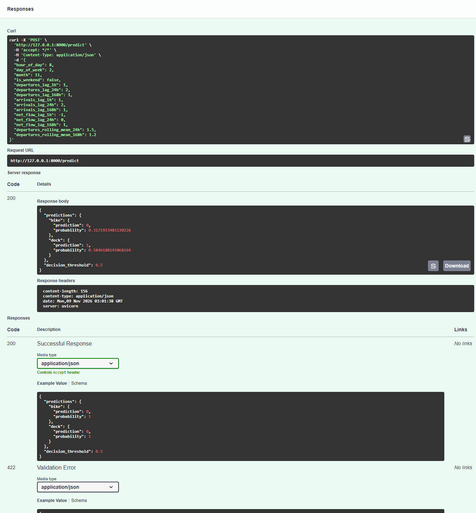

# Validación de integración de la API P2

## Alcance y base

Contribución del integrante 4: pruebas REST, ajustes de validación e inferencia, comprobación de Registry y contenedor, documentación y captura de evidencia.

Se trabajó exclusivamente en `feature/api-integration-validation`. La rama estaba en `6bb1120`, 23 commits detrás de `origin/main`. Con autorización expresa se actualizó por fast-forward a `34d0366`, que incluye los PR #21, #22 y #23. No se crearon commits, merges con commit, ramas nuevas, pushes ni PR. No se modificaron entrenamiento, umbral, versiones registradas, Makefile, Containerfile ni archivos de dependencias.

## Diagnóstico inicial

- No existían pruebas REST; las cinco pruebas de `tests/modeling/test_predict.py` verificaban la utilidad P1, no los endpoints P2.
- Pydantic permitía conversiones de tipos y campos desconocidos. Algunos NaN provocaban 500 al serializar errores y otros no finitos llegaban a la inferencia.
- `/predict` no tenía `response_model`; podía devolver probabilidades fuera de rango.
- Un solo modelo cargado permitía una respuesta parcial y `/health` seguía devolviendo 200.
- Se enviaba un DataFrame a estimadores P2 entrenados con matrices sin nombres, causando la advertencia de scikit-learn.
- Docker no utiliza `.containerignore`; faltaba limitar su contexto de construcción.
- La documentación de serving describía P1 y dejaba pendiente la distribución de modelos, aunque el servicio actual usa P2 exportado.

La primera ejecución de la nueva suite obtuvo **64 fallos y 72 aprobadas**, reproduciendo las deficiencias. Se corrigió la ruta de inferencia y validación; no se deshabilitaron pruebas existentes.

## Identidad y contrato reales

Exportación desde `http://127.0.0.1:5000`, usando el Registry local y sus artefactos existentes, sin entrenar ni registrar versiones nuevas. `models/metadata.json` registró `exported_at=2026-11-09T02:24:54+00:00` (UTC).

| Modelo | Alias | Versión | Run de origen |
|---|---|---|---|
| `mibici-p2-bike-pressure` | `champion` | 1 | `d306fe5f7f34496a94f8cc3d0db2f62b` |
| `mibici-p2-dock-pressure` | `champion` | 1 | `81f93c6f160e4f44afe3db913eac5030` |

Ambos artefactos `MLmodel` declaran MLflow 3.17.0, scikit-learn 1.9.1, serialización skops y firma de entrada tensorial `float32`, forma `[-1, 15]`. El orden se contrastó con `PREDICTOR_COLUMNS` y con el parámetro `predictor_columns` de cada run. El parámetro `decision_threshold` es 0.5 en ambos runs.

La API conserva las claves de respuesta y `model.predict()`. Para los HGB binarios, un empate exacto en 0.5 devuelve clase 0; se comprobó en la implementación de scikit-learn y con un estimador sintético mínimo. Las métricas históricas calculadas por `evaluate_probabilities` usan `>= 0.5`, por lo que pueden diferir en empates. No se cambió silenciosamente esa conducta ni se reescribieron métricas históricas.

La selección de `P(clase=1)` usa `classes_`, no una posición fija. La matriz `float32` evita la advertencia de nombres y respeta la firma registrada. Para la entrada de ejemplo se comprobó igualdad exacta de probabilidades respecto del DataFrame anterior, además de igualdad entre modelos exportados y Registry. Esa comprobación no constituye una garantía matemática sobre todas las entradas posibles. Los estimadores que sí exponen `feature_names_in_` conservan la entrada tabular.

## Cambios realizados

| Archivo | Justificación |
|---|---|
| `mibici/api/main.py` | Validación estricta, finitud y rango float32; respuesta Pydantic; errores 422 serializables sin reflejar el input; disponibilidad completa, limpieza de startup y matriz compatible con entrenamiento. |
| `tests/api/test_main.py` | 143 casos unitarios/documentales y 2 integraciones optativas independientes, con TestClient, fixtures y mocks únicamente en los casos unitarios. |
| `.dockerignore` | Contexto Docker limitado al código, dependencias y modelos P2 exportados; exclusión de secretos. |
| `.containerignore` | Excluir otros modelos locales y secretos anidados también con Podman. |
| `docs/examples/p2-request.json` | Entrada completa reproducible y validada; valores sintéticos, no datos reales. |
| `docs/evidence/api-container-prediction.png` | Captura real de Swagger ejecutando una petición contra el contenedor Docker. |
| `README.md` | Procedimiento de despliegue, contrato, consultas, pruebas, evidencia y diagnóstico de problemas, sin eliminar actividades anteriores. |
| `docs/mlflow_model_serving.md` | Distinguir la utilidad histórica P1 de la API P2 actual y su empaquetado. |
| `docs/api_validation.md` | Resultados, trazabilidad, matriz de requisitos y límites de la validación. |

## Pruebas y validaciones

Comandos ejecutados con Python 3.14.4 del entorno `.venv` del proyecto. No se instalaron dependencias globales. La imagen usa las versiones fijadas por el integrante 3; no se modificaron sus dependencias.

| Comprobación | Resultado real |
|---|---|
| `python -m pytest -q` | **279 aprobadas, 2 omitidas, 113 advertencias**, 622.76 s. Incluye las pruebas existentes de P1/P2/P3, MLflow y Deepchecks. |
| Integraciones con flags habilitados | **2 aprobadas, 143 deseleccionadas**, 5.66 s en la última ejecución. Incluye comparación con inferencia previa. |
| Casos distintos cubiertos | **281**, contando las dos integraciones por separado; no se suman ejecuciones repetidas como pruebas distintas. |
| `python -m ruff format --check` | **20 archivos con formato correcto**. |
| `python -m ruff check` | **All checks passed**. |
| Ruff explícito sobre `tests/api` | **All checks passed**; la configuración histórica no incluye tests por defecto. |
| `python -m pip check` en host | **No broken requirements found**. |
| `docker exec mibici-api python -m pip check` | **No broken requirements found**. |
| Importación de `mibici.api.main` | Correcta en pruebas y durante el arranque real de Uvicorn en la imagen. |
| OpenAPI | Esquemas de entrada y salida verificados con TestClient y documento real del contenedor. |
| Diagnósticos del editor en archivos Python cambiados | Sin errores. |
| Documentación | 26 enlaces locales existentes y 3 ejemplos JSON del README comprobados; entrada y respuesta validadas con Pydantic. |

Las 113 advertencias globales no se ocultaron: incluyen deprecaciones de MLflow, SQLAlchemy y Deepchecks; inferencia de enteros en firmas MLflow; clusters sintéticos duplicados; división por cero en la comparación de un baseline sintético; y deprecación de httpx en el Starlette del entorno de desarrollo. No bloquearon pruebas. La imagen utiliza FastAPI 0.121.3 y Pydantic 2.14.3; el entorno de desarrollo observado utilizó FastAPI 0.143.0 y Pydantic 2.14.1. El HTTP real se verificó con las versiones de la imagen.

Los reportes y las capturas históricos de seguridad/Deepchecks se conservan; no se presentan como una auditoría de seguridad nueva ni como garantía de ausencia de vulnerabilidades.

### Cobertura REST

- Salud y ambos modelos disponibles; respuesta JSON, clases y probabilidades de ambas predicciones.
- Rangos de hora/día/mes; ceros, flujos negativos válidos y probabilidades límite 0 y 1.
- Conteos y medias negativos, campos faltantes, null, tipos incorrectos y campos desconocidos.
- NaN, Infinity y -Infinity en los once campos numéricos, tanto cadenas como tokens JSON no estándar; desbordamiento de float32.
- Modelo ausente o disponibilidad parcial: 503 tanto en salud como en predicción.
- Orden de los 15 predictores, clases invertidas, salida inválida, empate 0.5 y errores internos no expuestos.
- Solo dos cargas por ciclo de vida, limpieza tras shutdown y tras fallo de startup.
- Firma y metadata reales del Registry, igualdad de probabilidades exportadas, inferencia sin advertencia de nombres y HTTP del contenedor.

Reproducción desde la raíz, con entorno activado y Registry/contenedor en marcha:

```powershell
python -m pytest -q
$env:MLFLOW_TRACKING_URI = "http://127.0.0.1:5000"
$env:MIBICI_API_INTEGRATION = "1"
$env:MIBICI_API_CONTAINER = "1"
python -m pytest tests/api/test_main.py -q -k "real_registry_export or live_container"
Remove-Item Env:MIBICI_API_INTEGRATION, Env:MIBICI_API_CONTAINER
```

## Contenedor y HTTP real

Podman y GNU Make no estaban disponibles en PATH. Docker Desktop sí estaba instalado, pero su motor estaba detenido. Se inició con `docker desktop start`; `docker info` confirmó el motor 29.8.0. Por tanto **no se ejecutaron Podman ni los targets make**; se ejecutaron sus equivalentes explícitos:

```powershell
python -m mibici.api.export_models
docker build -t mibici-api -f Containerfile .
docker run --rm -d -p 127.0.0.1:8000:8000 --name mibici-api mibici-api
docker inspect mibici-api
docker exec mibici-api python -m pip check
```

El build final terminó correctamente, conservando el Containerfile original y su digest de base. El contenedor final se inició con identificador `ab7f99b38fe7d0291ebfa642d0141c0104f6dd2d8560f9a57443003e852ed907`. Se comprobó usuario `app`, UID efectivo 10001 y ausencia de `.env`, `.git`, `.venv`, `data`, `mlartifacts`, `mlflow.db` y tests dentro de `/app`. Solo se empaquetan el código, requirements y modelos P2 con metadata. No se agregaron modelos, bases de datos ni credenciales a Git.

Se observó `running` y healthcheck `healthy`. La configuración conserva 30 s de intervalo, 5 s de timeout, 30 s de inicio y 3 reintentos, consultando `/health` en el puerto `PORT`. La ejecución verificada publicó únicamente `127.0.0.1:8000`.

Respuestas reales para [la entrada de ejemplo](examples/p2-request.json):

```text
GET /health -> HTTP 200
{"status":"healthy","models_loaded":["bike","dock"]}

POST /predict -> HTTP 200
{"predictions":{"bike":{"prediction":0,"probability":0.3171913481120226},"dock":{"prediction":1,"probability":0.5846188145068164}},"decision_threshold":0.5}
```

El smoke test también obtuvo HTTP 422 para hora 24, un campo extra y NaN. El contrato de error conserva `detail` con `loc`, `msg` y `type`, sin reflejar entradas no finitas ni detalles internos. No se necesita un servidor MLflow accesible desde el contenedor para servir los modelos locales.

Al cerrar la validación se detuvo el Registry temporal y se confirmó cerrado el puerto 5000. Se repitió el caso HTTP del contenedor: **1 aprobada, 144 deseleccionadas**, 3.32 s, con salud, predicción, OpenAPI y errores válidos incluso sin Registry activo. Es una repetición del caso ya contado, no una prueba distinta adicional. También se cerraron el navegador headless y el receptor temporal de capturas; el contenedor quedó activo para revisión local.

### Captura auténtica



La captura final fue obtenida de Swagger servido por el contenedor, mediante Edge headless con perfil temporal y Chrome DevTools Protocol. Se activaron `POST /predict`, `Try it out` y `Execute` con el ejemplo completo. Se confirmó HTTP 200 y se capturó el área de petición/respuesta en un PNG de 1337 x 1440 píxeles. Los intentos previos con Playwright del navegador integrado tenían problemas de encuadre y fueron reemplazados. No se inyectaron respuestas ni se fabricó una imagen. El estado de Docker se verificó por CLI por separado; no está mostrado dentro de esta captura.

Para repetirla manualmente, ejecutar `docker ps --filter name=mibici-api`, abrir `http://127.0.0.1:8000/docs`, expandir `POST /predict`, pulsar `Try it out`, pegar el contenido de `docs/examples/p2-request.json` y pulsar `Execute`. Capturar la URL, el HTTP 200 y ambos resultados. No confundir la respuesta del servidor con el ejemplo automático del esquema.

## Matriz de requisitos

Esta matriz corresponde a los requisitos del encargo. No se proporcionó el texto completo de la rúbrica ni sus ponderaciones; no constituye una certificación de 100/100.

| Requisito | Estado | Evidencia |
|---|---|---|
| Base con PR #21/#22/#23 y rama autorizada | Verificado | Fast-forward autorizado a `34d0366`; trabajo en la rama indicada. |
| Modelos P2 recuperados del Registry | Verificado | Alias, versiones, runs, exportación e integración real sin mocks. |
| 15 variables y orden de entrada | Verificado | Esquema, constante de entrenamiento, parámetros de runs y firma tensorial. |
| API validada y respuesta tipada | Verificado | Suite de API y HTTP 200/422 reales. |
| Falta de modelos y carga única | Verificado en unitarios | 503 parcial/total y dos cargas por lifespan; startup falla sin artefactos. |
| Probabilidades y clasificación sin cambio oculto | Verificado para entrada de prueba | Comparación de probabilidades y conservación de `predict`; diferencia de empate documentada. |
| Imagen y contenedor sin privilegios | Verificado con Docker | Build, arranque, UID, puerto, healthcheck y pip check. |
| Ejecución con Podman | No ejecutada | No instalado; Docker es la alternativa admitida. |
| Targets de Make | Revisados, no ejecutados | Make ausente; comandos equivalentes ejecutados. |
| Exclusión de datos, secretos y artefactos ajenos | Verificado con Docker | Contexto limitado y comprobación del contenido de `/app`. Reglas Podman revisadas, no ejecutadas. |
| Documentación de despliegue y consultas | Implementado | Sección 14 del README, ejemplo validado y este informe. |
| Captura desde contenedor | Verificado | PNG auténtico enlazado arriba, request y respuesta HTTP 200. |
| No regresiones detectadas en actividades anteriores | Verificado por suite | 279 aprobadas; no se modificaron módulos de entrenamiento ni tests previos. |
| Colaboración GitHub y revisión de otro integrante | Pendiente manual | Revisar diff, publicar branch/PR y completar revisión exigida por la rúbrica. |

## Pendientes manuales y límites

- Revisar la rúbrica oficial y confirmar campos, evidencias y revisión entre integrantes que no estén descritos en el encargo.
- Revisar, hacer commit, push y abrir el PR. No se hicieron automáticamente.
- Si se exige específicamente Podman en lugar de la alternativa Docker admitida, repetir build, arranque y smoke test con Podman en un equipo disponible; no se presenta esa ejecución como realizada.
- Los modelos y Registry son locales: otro equipo necesita acceso a los mismos artefactos para reproducir estas versiones y probabilidades.
- No se realizaron pruebas de carga, calibración, TLS, autenticación ni una auditoría nueva de dependencias con CVE. El servicio está validado para la demostración local, no certificado para producción.

## Revisión y publicación manual

Desde la raíz, sin agregar archivos locales ignorados ni reportes ajenos:

```powershell
git branch --show-current
git status --short
git diff --check
git diff --stat
git diff
git add .dockerignore .containerignore README.md mibici/api/main.py tests/api/test_main.py docs/examples/p2-request.json docs/api_validation.md docs/mlflow_model_serving.md docs/evidence/api-container-prediction.png
git diff --cached --stat
git diff --cached --check
git commit -m "test(api): validate P2 REST integration and container deployment"
git push -u origin feature/api-integration-validation
gh pr create --base main --head feature/api-integration-validation --title "test(api): validate P2 API and container deployment" --body-file docs/api_validation.md
```

El último comando requiere GitHub CLI autenticado. Como alternativa, después del push abrir la comparación de `feature/api-integration-validation` contra `main` en GitHub y adjuntar este informe y la captura.

## Control de contenido Antislop

Se aplicó el modo durante, elegido para esta sesión. El alcance es backend, pruebas y documentación técnica: no se diseñó una interfaz propia. Las reglas de composición visual, diales, temas y accesibilidad de una UI nueva no aplican; no se certifica aquí la accesibilidad de Swagger.

- R-02 PASS: no se agregaron rayas largas en la documentación nueva; las secciones históricas se conservaron.
- R-17 PASS: conteos y resultados proceden de Pytest, Ruff, metadata y respuestas HTTP observadas.
- R-23 PASS: la captura fue solicitada expresamente y muestra una ejecución auténtica.
- R-24 PASS: los 26 enlaces locales revisados resuelven a archivos existentes.
- R-35 PASS: aplicación ejecutada en Docker; GET de salud, POST válido e inválido y OpenAPI probados; Swagger expandido, edición habilitada y petición ejecutada.
- R-36 PASS: se distinguen limitaciones, herramientas no ejecutadas y ausencia de garantía de calificación o preparación para producción.
- R-38 PASS: entrada sintética identificada como tal; respuesta y versiones respaldadas por la integración real.
- C-5 PASS: no se crearon testimonios, resultados, modelos ni afirmaciones de rendimiento ficticios.