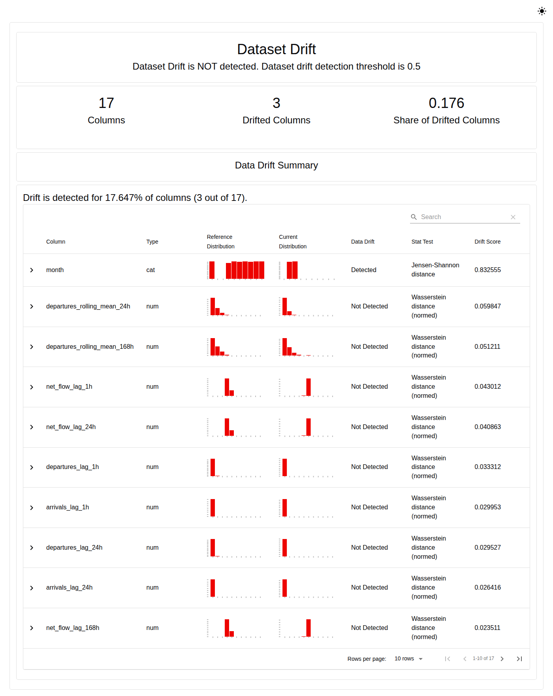
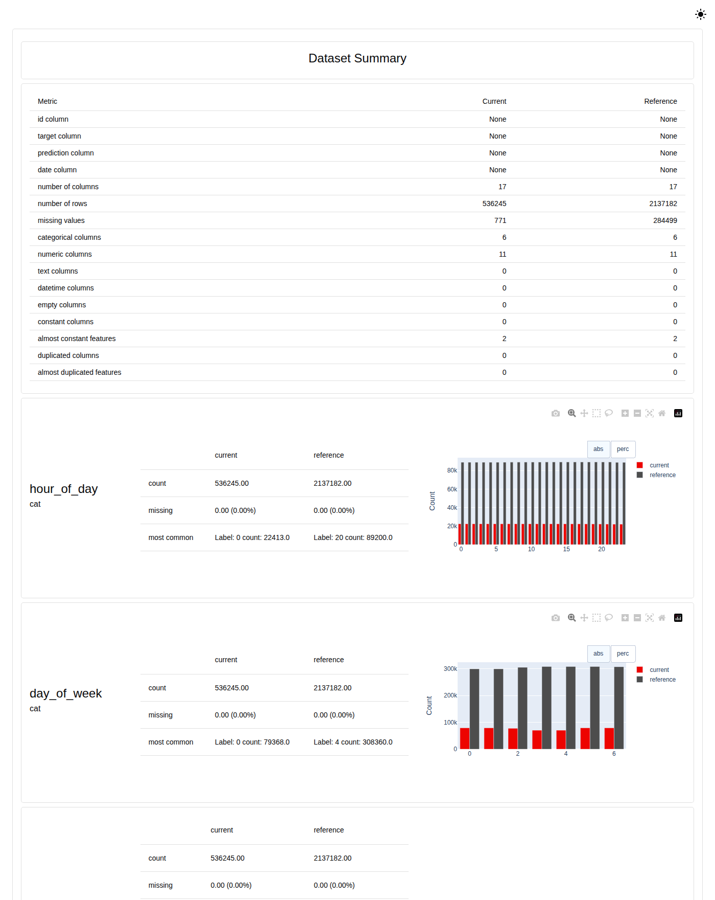

# Interpretación del drift — MiBici P2 (Equipo 28)

Análisis del reporte de Evidently que compara los datos con los que se entrenó el clasificador P2 contra un periodo posterior que hace las veces de producción. Identifica las variables con drift significativo y explica sus implicaciones para el modelo.

## Resumen

**Sí hay drift.** Evidently marca 3 de 17 variables: `month` (drift estructural: noviembre y diciembre nunca aparecen en train) y las dos etiquetas (la prevalencia de presión baja 29 % en bicicletas y 16 % en anclajes). Las variables de flujo reciente, que son la señal principal del modelo, siguen estables. El modelo conserva su capacidad de ordenar estaciones por riesgo, pero pierde precision con el umbral actual: conviene reentrenarlo con meses recientes.

El encabezado del reporte, "Dataset Drift is NOT detected", solo significa que no se alcanzó el criterio global por defecto de Evidently (50 % de las variables con drift); no significa que los datos no hayan cambiado.

Reportes interactivos: [data_drift_report.html](../reports/evidently/data_drift_report.html) y [data_quality_report.html](../reports/evidently/data_quality_report.html). Resultados por variable en [drift_summary.json](../reports/evidently/drift_summary.json). Para regenerarlos: `python -m mibici.monitoring.drift_report` (sección 15 del README).

## 1. Configuración del análisis

| Elemento | Valor |
|---|---|
| Modelo monitoreado | P2: `mibici-p2-bike-pressure@champion` y `mibici-p2-dock-pressure@champion` (v1), el modelo que sirve la API |
| Reference | Enero-agosto de 2025, partición train del champion: 2,137,182 filas |
| Current | Noviembre-diciembre de 2025, periodo posterior al entrenamiento y a la selección: 536,245 filas |
| Variables | Las 15 entradas del modelo (`PREDICTOR_COLUMNS`) y las dos etiquetas (`target_bike_pressure`, `target_dock_pressure`) |
| Etiquetas de current | Calculadas con los umbrales de presión ajustados solo con train (0.3684 para ambas), idénticos a los registrados en MLflow |
| Pruebas estadísticas | Elegidas por Evidently para muestras grandes: distancia de Wasserstein normalizada en las 11 numéricas y distancia de Jensen-Shannon en las 4 de calendario (drift si la distancia es ≥ 0.1). En las dos etiquetas se usa la prueba Z de proporciones (drift si p < 0.05), ver sección 4.2 |

Septiembre-octubre no se usa como current porque es la partición validation con la que se eligió el champion: no representa datos que el modelo no haya influido. Noviembre-diciembre es el primer periodo que el modelo no vio ni en entrenamiento ni en selección.

## 2. Resultados

| Variable | Tipo | Prueba | Puntaje | Drift |
|---|---|---|---:|---|
| `month` | cat | Jensen-Shannon | **0.8326** | **Sí** |
| `target_bike_pressure` | cat | Z de proporciones (p-value) | **p < 0.001** | **Sí** |
| `target_dock_pressure` | cat | Z de proporciones (p-value) | **p < 0.001** | **Sí** |
| `departures_rolling_mean_24h` | num | Wasserstein | 0.0598 | No |
| `departures_rolling_mean_168h` | num | Wasserstein | 0.0512 | No |
| `net_flow_lag_1h` | num | Wasserstein | 0.0430 | No |
| `net_flow_lag_24h` | num | Wasserstein | 0.0409 | No |
| `departures_lag_1h` | num | Wasserstein | 0.0333 | No |
| `arrivals_lag_1h` | num | Wasserstein | 0.0300 | No |
| `departures_lag_24h` | num | Wasserstein | 0.0295 | No |
| `arrivals_lag_24h` | num | Wasserstein | 0.0264 | No |
| `net_flow_lag_168h` | num | Wasserstein | 0.0235 | No |
| `day_of_week` | cat | Jensen-Shannon | 0.0207 | No |
| `departures_lag_168h` | num | Wasserstein | 0.0062 | No |
| `is_weekend` | cat | Jensen-Shannon | 0.0061 | No |
| `arrivals_lag_168h` | num | Wasserstein | 0.0039 | No |
| `hour_of_day` | cat | Jensen-Shannon | 0.0019 | No |

En el HTML, la tabla está ordenada por puntaje: las dos etiquetas (p-value ≈ 0) aparecen en la segunda página.

Evidently concluye **"Dataset Drift is NOT detected"** porque 3 de 17 variables (17.6 %) no alcanzan el criterio global por defecto del 50 %. Esa conclusión es engañosa para este modelo: las tres variables con drift son justamente las que más afectan su desempeño (sección 4).

## 3. Calidad de los datos

| Indicador | Reference | Current | Lectura |
|---|---:|---:|---|
| Valores faltantes | 284,499 | 771 | Solo en rezagos y medias móviles: son las primeras horas sin historia (369/8,856/61,992 para 1h/24h/168h en train; 1/24/168 en current, de una estación con historia corta). Esperado y tolerado por HistGradientBoosting |
| Columnas vacías, constantes o duplicadas | 0 | 0 | Sin problemas estructurales |
| Variables casi constantes | 2 | 2 | Las dos etiquetas (≈96 % de ceros): es el desbalance de clases propio de P2, no un defecto |
| Máximo de `departures_lag_1h` | 75 | 109 | En diciembre aparecen valores fuera del rango visto en train |

La calidad de current es comparable a la de reference: el drift no se explica por errores de ingesta.

## 4. Variables con drift significativo y sus implicaciones

### 4.1. `month` — drift estructural (Jensen-Shannon 0.83)

Reference solo contiene los meses 1-8 y current solo los meses 11 y 12: no hay ninguna categoría en común. No es un cambio gradual de distribución, sino valores que el modelo nunca vio.

**Implicación.** HistGradientBoosting trata `month` como numérica y sus cortes se aprendieron entre 1 y 8. Todas las filas de noviembre y diciembre caen del lado "≥ último corte", así que el modelo las trata como si fueran agosto. Cualquier efecto estacional propio de fin de año (vacaciones de diciembre, menor demanda) queda fuera de lo que el modelo puede representar con esta variable; solo lo capta indirectamente por los rezagos. El riesgo crece en cada mes nuevo que se aleje del comportamiento de agosto, y será igual en 2026 mientras el modelo no se reentrene con un año completo.

### 4.2. `target_bike_pressure` y `target_dock_pressure` — cambio de prevalencia (prior shift)

Con la prueba por defecto (Jensen-Shannon) las etiquetas no cruzaban el umbral (0.023 y 0.013): esa distancia casi no reacciona en variables binarias con ≈4 % de positivos. Por eso se configuró la prueba Z de proporciones para ambas etiquetas (`per_column_method` en `mibici/monitoring/drift_report.py`), que detecta el cambio con p < 0.001. Con muestras de este tamaño cualquier diferencia resulta significativa, así que lo relevante es la magnitud:

| Etiqueta | Reference | Current | Cambio relativo |
|---|---:|---:|---:|
| `target_bike_pressure` | 4.34 % | 3.09 % | **−29 %** |
| `target_dock_pressure` | 4.10 % | 3.43 % | −16 % |

Además, la tendencia ya existía dentro de train: la presión de bicicletas bajó de 4.80 % en febrero a 3.92 % en agosto, y en diciembre llega a 2.69 %. Es un drift gradual, no un salto aislado.

### 4.3. Cambios sin drift significativo

**Demanda reciente.** Las medias móviles de salidas son las numéricas con mayor puntaje (0.060 y 0.051). La media de 168 h pasa de 1.42 viajes por estación-hora en reference a 1.47 en noviembre y 1.28 en diciembre, consistente con la caída de actividad por vacaciones.

**Implicaciones para el desempeño.** Ambos cambios ya se observan en la evaluación final de los champion ([test_evaluation.md](../reports/test_evaluation.md)):

| Objetivo | AP val | AP test | Precision val → test | Recall val → test | AP / prevalencia val → test |
|---|---:|---:|---|---|---|
| Presión de bicicletas | 0.324 | 0.262 | 0.148 → 0.119 | 0.841 → 0.818 | 7.9× → 8.5× |
| Presión de anclajes | 0.388 | 0.365 | 0.154 → 0.136 | 0.849 → 0.841 | 9.2× → 10.6× |

- **La caída de AP y de precision se explica sobre todo por la menor prevalencia.** El AP de un clasificador aleatorio es igual a la prevalencia; normalizado por ella, el modelo ordena igual o mejor en current (8.5× frente a 7.9×). La capacidad de distinguir estaciones en riesgo se conserva.
- **El umbral de decisión fijo (0.5) queda desalineado.** Con menos positivos reales y el mismo umbral, crece la proporción de falsas alarmas: en current hubo 100,714 falsos positivos contra 13,537 verdaderos positivos en presión de bicicletas. Para la operación (rebalanceo de bicicletas) eso significa más visitas innecesarias.
- **Las entradas principales del modelo siguen estables.** Los rezagos y las medias móviles, que son la señal predictiva principal, no tienen drift significativo; por eso el modelo sigue muy por encima del baseline (AP 0.262 frente a 0.031).
- **Valores fuera de rango.** Los máximos nuevos (109 salidas en una hora frente a 75) caen en la última hoja de cada árbol: el modelo satura su respuesta en lugar de extrapolar. Afecta a pocas filas.

## 5. Conclusiones y recomendaciones

1. **Hay drift y el modelo ya muestra señales de envejecimiento, aunque sigue siendo útil.** No hay drift en las variables de flujo, pero `month` está fuera de dominio y la prevalencia de las etiquetas cae de forma sostenida, lo que reduce la precision con el umbral actual.
2. **Reentrenar incluyendo los meses recientes** (al menos septiembre-diciembre o un año completo) para que `month` cubra todo el calendario y el modelo aprenda la prevalencia actual. Es la versión alternativa natural para el A/B testing.
3. **Revisar el umbral de decisión** con datos recientes, o reemplazar `month` por una codificación cíclica, para reducir la dependencia de meses vistos.
4. **No depender del veredicto global de Evidently.** En el monitoreo continuo conviene alertar por variable (categorías nuevas en `month`, drift en las etiquetas) y acompañar la prueba Z con un umbral de magnitud, por ejemplo un cambio relativo de prevalencia mayor a 20 %, porque con muestras grandes la prueba Z marca hasta diferencias mínimas.
5. **Repetir el reporte cada mes** con `python -m mibici.monitoring.drift_report`; MiBici ya publica los datos de 2026, que serían el siguiente current.

## 6. Limitaciones

- Noviembre-diciembre es el test reservado del proyecto y ya se usó una vez para la evaluación final; aquí solo se analiza, no se usa para entrenar ni para elegir modelos.
- Son dos meses con estacionalidad marcada (vacaciones); parte del cambio puede ser estacional y no permanente.
- Las etiquetas P2 son proxies construidos con el catálogo de capacidades de 2026-09, no inventarios reales de bicicletas o anclajes.
