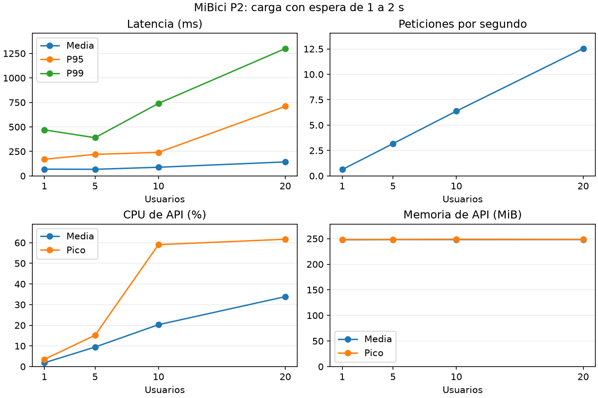

# Cierre de despliegue P2: evidencia del Model Card

Rama `feature/anthony-final-deployment-operations`. Base local y `origin/main`: `4c576efc86d55c828e7101d47628f78ea23b89ff`, con #33, #34 y #35 integrados. Verificación en Windows PowerShell desde el 26/11/2026 (Lima, UTC−5). El worktree contiene los cambios bajo revisión, sin publicar. La [evidencia del 25/11](validation.md) y su [CSV preliminar](preliminary_load.csv) se mantienen intactos.

## Linaje y compatibilidad

El [Model Card](../../model_card.md) es la referencia operativa del despliegue, según la decisión del equipo para esta ejecución. Se consultó SQLite local con `mode=ro`: se cruzaron `registered_model_aliases` / `model_versions` por nombre y versión y se leyeron `params`, `tags` y `latest_metrics` por `run_uuid`. Los runs de este registro, los `MLmodel` y `models/metadata.json` coinciden.

| Objetivo, alias `champion` v1 | Run local | `val_average_precision` del SQLite | Run y AP de [#34](../../model_registry_final.md) |
|---|---|---:|---|
| Bike | `d306fe5f7f34496a94f8cc3d0db2f62b` | 0.32421020202761053 | `3cecf9c99fdc477abce610da3a04af13`, 0.317719 |
| Dock | `81f93c6f160e4f44afe3db913eac5030` | 0.388195635363379 | `1b89a7da4676463e8f9421f5f09fdf51`, 0.379491 |

El run de entrenamiento registrado para cada modelo lleva el tag Git `cb6461e56237d1fc4617415f442201aff83fec58`; no es el SHA del build de la API. Ambos estimadores cargados en host son `HistGradientBoostingClassifier`, con `learning_rate=0.2`, `max_leaf_nodes=63`, `max_iter=100`, `n_iter_=100`, `early_stopping=False`, `random_state=42` y clases `[0, 1]`. Los parámetros de MLflow registran decisión 0.5 y los 15 predictores en el orden de la API. Los dos `MLmodel` declaran tensor `float32 [-1,15]` de entrada y `int8 [-1]` de salida. MLflow 3.17.0, scikit-learn 1.9.1, skops 0.16.0, NumPy 2.5.4, pandas 3.0.6 y SciPy 1.18.1 coinciden con el runtime. No se reentrenó, reemplazó ni promovió nada.

El [manifiesto SHA256](model_card_export_sha256.json) cubre **17 archivos**: metadata y el contenido completo de los dos directorios. No contiene pesos, ejemplos originales, URI de tracking, credenciales ni DB. El preflight valida alias, versión, patrón de almacenamiento y run de cada `MLmodel`, y con `--expected-report` compara rutas y SHA256, rechazando archivos faltantes, adicionales o modificados. Pasó tanto en host como en `/app/models` dentro del contenedor; la raíz de este último contiene exactamente `metadata.json` y las dos carpetas P2.

La identidad de los artefactos de esta imagen no se extrapola al Registry del integrante 2. El merge de #34 incorporó solo su documentación y PDF. La discrepancia queda visible; no se editó ni sustituyó esa evidencia.

## Build, Compose y HTTP

- Docker Desktop Linux y cliente 29.8.0, Compose v5.5.1. Host Intel Core Ultra 7 155U, 12 núcleos físicos / 14 lógicos; motor: 14 CPU, 33 372 114 944 bytes de RAM.
- La receta de [proyecto aislado](../../final_deployment_handoff.md#comandos-para-capturas-y-demo) usó `mibici-int3-final-4c576ef`, imagen `mibici-api:int3-modelcard-4c576ef`, puerto API 18000 y MLflow 15000, ambos publicados solo en loopback. Los puertos 8000/5000 ya estaban ocupados por el Compose original, que no se modificó.
- `docker compose config --quiet` y configuración con override: exit 0; servicios `mlflow` y `api`. `up -d --build --wait --wait-timeout 300`: exit 0, 131.57 s, ambos `healthy`.
- Imagen local de la API: `sha256:b120e539e9d63aeaf909b75354ec1db1aee3b57956a386a4c331052e52b570c0`. Contenedor API `7b3d9364347b…`, 1 vCPU, 512 MiB, 1 worker, `OMP_NUM_THREADS=1`, sin montajes. Python 3.14.10, FastAPI 0.121.3, Uvicorn 0.38.0 y `mlflow-skinny` 3.17.0.
- MLflow `v3.17.0` (`sha256:78803b7afd156eced665b023554bc199a4723d4466e7cba3732f7284f3cddd11`), 1 vCPU, 2560 MiB, volumen propio en `/mlflow`. No se usó como Registry de origen.

HTTP en la API: `/health` respondió `{"status":"healthy","models_loaded":["bike","dock"]}`; `/docs` y `/openapi.json` respondieron 200. `/health` de MLflow también respondió 200. Para `POST /predict` se usó el [ejemplo sintético](../../examples/p2-request.json); respuesta real HTTP 200:

```json
{"predictions":{"bike":{"prediction":0,"probability":0.3171913481120226},"dock":{"prediction":1,"probability":0.5846188145068164}},"decision_threshold":0.5}
```

Con `MIBICI_API_CONTAINER=1`, `MIBICI_API_URL=http://127.0.0.1:18000` y `MIBICI_API_MODELS_DIR` en el export local, `python -m pytest tests\api -q -rs` dio **153 passed, 1 skipped**, exit 0 (19.42 s de pytest / 44.78 s de reloj). Incluye tres rechazos 422 (hora fuera de rango, campo desconocido y NaN) y paridad entre inferencia directa y HTTP para tres inputs sintéticos × dos modelos. El único skip es la prueba contra un servidor de Registry autenticado; se verificó el origen por SQLite en solo lectura, no por HTTP.

## Calidad y CI

`python -m pytest -q -rs`: **320 passed, 3 skipped, 94 warnings**, exit 0 (1854.52 s de pytest / 1913.27 s de reloj). Sin flags de integración, con `OMP_NUM_THREADS=OPENBLAS_NUM_THREADS=MKL_NUM_THREADS=1` y `PYTHONUTF8=1`. Los skips fueron HTTP real, paridad y Registry autenticado. HTTP y paridad se ejecutaron con éxito en la suite focalizada descrita arriba; no se activó el test optativo del Registry autenticado. Los avisos incluyen deprecaciones de dependencias, firmas de MLflow y convergencia de clustering con fixtures sintéticos.

`ruff format --check` y `ruff check`: exit 0 en alcance por defecto (27 archivos Python formateados) y en los cuatro archivos Python modificados, comprobados explícitamente porque `include` del proyecto solo cubre el paquete. Pylance no encontró errores de sintaxis en el preflight, sus tests ni el runner.

El [run 45937362101](https://github.com/josafaatr1/TC5061-Proyecto-Equipo28/actions/runs/45937362101/job/140303558918) completó con `success` para `4c576efc86d55c828e7101d47628f78ea23b89ff` en `main`: checkout, instalación, pytest, dos pasos de Ruff y build. El worktree mantiene un paso adicional `docker compose config --quiet`, validado localmente. No hay run para la rama en su estado actual: no hubo commit ni push. El workflow construye la imagen de CI sin modelos privados; no publica ni despliega a producción.

También pasó `docker build -t mibici-api:ci-int3-4c576ef -f Containerfile <contexto limpio>` (exit 0). El contexto temporal solo incluía los inputs del Containerfile, con `models/.gitkeep` y sin el export privado. Una inspección con Python dentro de esa imagen confirmó `/app/models` vacío. Este build no sirve para validar inferencia; esa comprobación se hizo por separado sobre la imagen de Compose con el export.

## Carga y exportación

Locust 2.47.0 con `requirements-load.txt` en un venv aislado. `--csv` abre un escritor periódico en un greenlet; en la ejecución anterior dos escenarios cerraron los ficheros mientras seguía el escritor, con `ValueError: I/O operation on closed file` y conteos parciales. El código instalado (`locust/main.py`, `locust/stats.py`) confirma que `--json-file` guarda una vez después de `runner.quit()`. La opción toma un prefijo, sin `.json`; no combinar con `--json` porque ambas salidas serializan con `get_stripped_report()`, que reinicia las entradas de estadísticas.

El [runner](../../../tests/load/run_final.py) usa solo una salida JSON final por escenario, conserva stderr localmente, compara los conteos del JSON (total, histograma y serie por segundo) con el número de `POST /predict` HTTP 200 de los access logs Docker y luego genera CSV y gráfico. El monitor existente captura recursos de la API; se recorta a la ventana de Locust, de inicio a última respuesta. El RPS usa esa ventana, no divide por el tiempo de importación o cierre.

El 26/11/2026, entre las 23:36 y las 23:42 en Lima, los cuatro escenarios salieron con código 0 y sin errores de cierre. Total: **1135 solicitudes, 1135 respuestas HTTP 200, 0 fallos**. El conteo de cada JSON coincidió con el histograma de latencias, la serie por segundo, el resumen CSV y el conteo independiente del access log. Los 60 s son el límite configurado en Locust, no la ventana observada de respuestas: los timestamps del reporte registraron entre 45.73 y 51.45 s por caso. P95 y P99 usan el histograma redondeado de Locust.

| Usuarios | Solicitudes / HTTP 200 | Fallos | RPS | Media / P95 / P99 (ms) | CPU media / pico (%) | RAM media / pico (MiB) | Muestras |
|---:|---:|---:|---:|---:|---:|---:|---:|
| 1 | 31 / 31 | 0 | 0.621 | 68.679 / 170 / 470 | 1.83 / 3.47 | 247.88 / 248.10 | 12 |
| 5 | 145 / 145 | 0 | 3.171 | 67.287 / 220 / 390 | 9.46 / 15.19 | 248.14 / 248.40 | 12 |
| 10 | 314 / 314 | 0 | 6.378 | 88.111 / 240 / 740 | 20.29 / 59.06 | 248.15 / 248.80 | 13 |
| 20 | 645 / 645 | 0 | 12.535 | 142.718 / 710 / 1300 | 33.87 / 61.65 | 248.17 / 248.50 | 14 |

Fuentes: [resumen CSV](model_card_load/load_summary.csv), [muestras de recursos](model_card_load/resource_samples.csv) y JSON de [1](model_card_load/u1.json), [5](model_card_load/u5.json), [10](model_card_load/u10.json) y [20](model_card_load/u20.json) usuarios. La memoria y CPU corresponden al contenedor API, con un límite de 512 MiB y 1 vCPU. Las muestras son discretas, no garantizan capturar picos instantáneos. La prueba espera de 1 a 2 s entre consultas y no mide capacidad máxima, SLA ni costo.



## Cierre del entorno

A las 23:44 se ejecutó `down` solo para `mibici-int3-final-4c576ef`, sin `-v`. No quedaron contenedores de ese proyecto; se confirmó el volumen `mibici-int3-final-4c576ef_mlflow-data`. El Compose original en 8000/5000 seguía `healthy`. Sus IDs habían cambiado desde el inicio: los contenedores en uso se crearon a las 23:16, antes del `down` aislado. No se ejecutaron comandos de escritura sobre ese proyecto.
