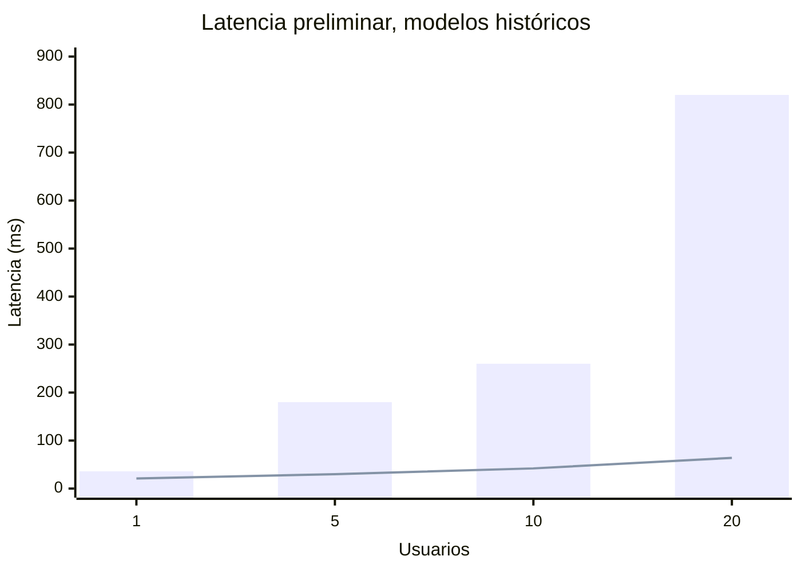

# MiBici: despliegue y operación de P2

Integrante 3 · Proyecto final TC5061 · Criterio de despliegue y operación (25/100 puntos).

**Referencia operativa:** los dos `champion` v1 del [Model Card](model_card.md), corroborados con los artefactos y el SQLite local. Los cambios están sin publicar; GitHub Actions solo tiene resultados para commits ya publicados.

## Auditoría y alcance

| Criterio | Componente que se reutiliza | Evidencia y estado | Acción de cierre |
|---|---|---|---|
| FastAPI contenerizada | [Containerfile](../Containerfile), [API](../mibici/api/main.py), [tests REST](../tests/api/test_main.py) | El [registro del cierre](evidence/final_deployment/model_card_validation.md) distingue salud, contrato, paridad y contenido de la imagen. | En la demo, mostrar el HTTP real del build verificado. |
| Docker Compose | [Compose](../docker-compose.yml), [manual](compose_operations.md) | Los puertos 8000/5000 estaban ocupados; se usó un proyecto aislado en 18000/15000. [Persistencia histórica](evidence/compose/validation.md#persistencia-real). | Conservar el nombre/volumen del proyecto original; no ocupar sus puertos. |
| GitHub Actions | [Workflow](../.github/workflows/ci.yml) | [Run de `main`](https://github.com/josafaatr1/TC5061-Proyecto-Equipo28/actions/runs/45937362101) para `4c576efc86d55c828e7101d47628f78ea23b89ff`; los cambios de esta rama no se han publicado. | Revisar tests, Ruff, Compose config y build en el run asociado al SHA aprobado. |
| Carga con Locust | [Escenario normal](../tests/load/locustfile.py), [monitor](../tests/load/monitor_resources.py), [metodología](../tests/load/README.md) | El [registro del cierre](evidence/final_deployment/model_card_validation.md) contiene los cuatro escenarios. La [prueba preliminar](evidence/final_deployment/validation.md#locust-preliminar) se conserva intacta. | Usar el JSON final y no el CSV periódico para contar solicitudes. |

La API sirve solo P2: presión de bicicletas (`bike`) y de anclajes (`dock`). P1/P3 quedan fuera. El flujo es **Registry de origen → export fuera de Git → `COPY models/` → carga de ambos estimadores al arrancar FastAPI**. El MLflow de Compose sirve tracking local con SQLite y artefactos en un volumen nombrado, pero no se usa para resolver los modelos empacados. No se tocaron DB, aliases ni registros del equipo; tampoco se repitió la recreación usada antes para comprobar persistencia.

## Linaje operativo y discrepancia del Registry

El 26/11/2026 (Lima), `HEAD` y `origin/main` coincidían en `4c576efc86d55c828e7101d47628f78ea23b89ff`, con #33, #34 y #35 integrados. El merge de [#34](https://github.com/josafaatr1/TC5061-Proyecto-Equipo28/pull/34) trajo documentación y evidencia, no modelos.

| Modelo (`champion` v1) | Run y AP val del Model Card / SQLite local | Run y AP val del Registry documentado por el integrante 2 |
|---|---|---|
| `mibici-p2-bike-pressure` | `d306fe5f7f34496a94f8cc3d0db2f62b`, `0.3242` | `3cecf9c99fdc477abce610da3a04af13`, `0.317719` |
| `mibici-p2-dock-pressure` | `81f93c6f160e4f44afe3db913eac5030`, `0.3882` | `1b89a7da4676463e8f9421f5f09fdf51`, `0.379491` |

El cierre local usa los artefactos del Model Card por decisión explícita. Los IDs coinciden en `metadata.json`, `MLmodel` y el SQLite de origen consultado en modo lectura. Los dos estimadores son `HistGradientBoostingClassifier` con `learning_rate=0.2`, `max_leaf_nodes=63`, `max_iter=100`, `early_stopping=False` y `random_state=42`. Las AP concuerdan al redondear a cuatro decimales; no se recalcularon ni se reentrenó. Los IDs y métricas de [model_registry_final.md](model_registry_final.md) corresponden al otro registro documentado. El Model Card explica cómo un entrenamiento con valores por defecto puede obtener AP cercanas a las de ese documento; eso no prueba cómo se ejecutaron sus runs. No se modificaron los documentos de otros integrantes ni sus aliases.

## Repetición en un clon limpio (PowerShell)

Usar Python 3.14 y el venv de [instalación](../README.md#6-instalación), Docker Desktop con motor Linux, Compose y espacio disponible. `git ls-files models` en un clon devuelve solo `models/.gitkeep`. Desde la raíz, comprobar quién ocupa cada puerto y usar el [proyecto aislado](final_deployment_handoff.md#comandos-para-capturas-y-demo) si hay un Compose existente.

### 1. Verificar origen y exportar sin sobrescribir

Para repetir **exactamente** el build validado, obtener una copia byte por byte del export del Model Card por canal autorizado. Si se consulta su Registry de origen, establecer `MLFLOW_TRACKING_URI` y las credenciales solo por el mecanismo autorizado; si hay un Registry distinto al tracking, establecer también `MLFLOW_REGISTRY_URI`. No usar automáticamente `127.0.0.1:5000` ni el MLflow de Compose.

```powershell
$py = '.\.venv\Scripts\python.exe'
$stage = Join-Path $env:TEMP ("mibici-export-" + [guid]::NewGuid().ToString('N'))
@'
from mlflow import MlflowClient
from mibici.api.export_models import EXPORTED_MODELS

client = MlflowClient()
for name in EXPORTED_MODELS:
    model = client.get_model_version_by_alias(name, "champion")
    print(model.name, "champion", model.version, model.run_id)
'@ | & $py -
```

Continuar solo si ambos registros coinciden con la confirmación. Volver a cotejar después del export, por si se movió el alias. Como alternativa sin acceso al Registry, recibir el export completo en `$stage`.

```powershell
& $py -m mibici.api.export_models --alias champion --output-dir $stage
if ($LASTEXITCODE -ne 0) { throw 'Falló el export; no construir.' }
```

El preflight coteja linaje y contenido con el [manifiesto verificado](evidence/final_deployment/model_card_export_sha256.json) de esta entrega. Una exportación nueva puede regenerar metadata aunque coincidan los pesos: no reemplazar la referencia solo para hacer pasar el check. Si cambia el export, cotejar con la fuente autorizada y registrar una referencia nueva junto con una validación nueva.

```powershell
$lineage = @('--alias', 'champion', '--bike-version', '1', '--bike-run-id', 'd306fe5f7f34496a94f8cc3d0db2f62b',
             '--dock-version', '1', '--dock-run-id', '81f93c6f160e4f44afe3db913eac5030')
$reference = 'docs\evidence\final_deployment\model_card_export_sha256.json'
& $py -m mibici.api.preflight --models-dir $stage @lineage --expected-report $reference
if ($LASTEXITCODE -ne 0) { throw 'El export no coincide; no construir.' }
git check-ignore models/metadata.json models/p2-bike-pressure/MLmodel models/p2-dock-pressure/model.skops
```

Revisar `MLmodel` y `requirements.txt` de ambos artefactos contra [requirements-api.txt](../requirements-api.txt): firma, tipos, 15 features en el orden de entrenamiento y versiones de MLflow, sklearn, skops y bibliotecas numéricas. No corregir discrepancias cambiando los modelos. En un **clon limpio** (sin export previo) copiar los dos directorios completos y `metadata.json` de `$stage` a `models\`. Si ya hay export, respaldar las dos carpetas y la metadata juntas fuera del contexto; no mezclar archivos de distintos exports. El `MLmodel` y `model.skops` deben quedar directamente bajo cada `p2-*-pressure`.

### 2. Construir, probar por HTTP y cotejar el contenido empacado

Los siguientes comandos usan el proyecto y los puertos por defecto. Si ya hay un despliegue, usar en su lugar `$c` y `$apiUrl` del handoff. En ese caso, reemplazar cada `docker compose` por `docker @c` y no cambiar los puertos del despliegue existente.

```powershell
& $py -m mibici.api.preflight --models-dir .\models @lineage --expected-report $reference
if ($LASTEXITCODE -ne 0) { throw 'Preflight del contexto falló.' }
docker compose config --quiet
if ($LASTEXITCODE -ne 0) { throw 'Configuración Compose inválida.' }
docker compose config --services
docker compose up -d --build --wait --wait-timeout 300
if ($LASTEXITCODE -ne 0) { throw 'Compose no alcanzó healthy.' }
docker compose ps
$api = docker compose ps -q api
docker inspect --format 'image={{.Image}} health={{.State.Health.Status}}' $api
Get-Content -Raw $reference | docker compose exec -T api python -m mibici.api.preflight `
    --models-dir /app/models @lineage --expected-report /dev/stdin
if ($LASTEXITCODE -ne 0) { throw 'Preflight del contenedor falló.' }

$apiUrl = 'http://127.0.0.1:8000'
Invoke-RestMethod "$apiUrl/health"
$openapi = Invoke-RestMethod "$apiUrl/openapi.json"
$openapi.paths.PSObject.Properties.Name
$sample = Get-Content -Raw .\docs\examples\p2-request.json
Invoke-RestMethod -Method Post -Uri "$apiUrl/predict" -ContentType 'application/json' -Body $sample
```

Registrar fecha, SHA, ID/digest, versiones, límites efectivos, `docker compose ps` y logs sanitizados. La petición es sintética. Esperar HTTP 200, ambos modelos, clases enteras 0/1 y probabilidades dentro de [0,1]; la respuesta comunica `decision_threshold: 0.5`. La etiqueta se compara contra `predict()` del estimador, sin reinterpretar empates mediante `>= 0.5`.

En una terminal de prueba aislada, usar estos flags (no cambiar variables globales del equipo):

```powershell
$env:OMP_NUM_THREADS = $env:OPENBLAS_NUM_THREADS = $env:MKL_NUM_THREADS = '1'
$env:PYTHONUTF8 = '1'
$env:MIBICI_API_CONTAINER = '1'
$env:MIBICI_API_URL = $apiUrl
$env:MIBICI_API_MODELS_DIR = (Resolve-Path .\models).Path
try {
    & $py -m pytest tests\api -q -rs
    if ($LASTEXITCODE -ne 0) { throw 'Fallaron las pruebas de API.' }
} finally {
    Remove-Item Env:MIBICI_API_CONTAINER,Env:MIBICI_API_URL,Env:MIBICI_API_MODELS_DIR
}
& $py -m pytest -q -rs
& $py -m ruff format --check
& $py -m ruff check
$targets = @('tests\api\test_main.py', 'tests\api\test_preflight.py', 'tests\load\run_final.py')
& $py -m ruff format --check @targets
& $py -m ruff check @targets
```

El test de HTTP comprueba OpenAPI, Swagger y errores 422. El de paridad compara tres entradas sintéticas contra los artefactos directos: mismos nombres/orden de columnas para estimadores con `feature_names_in_`, tensor `float32` para los otros, clase positiva por `classes_`, igualdad de clase y error absoluto `≤ 1e-9` para diferencias de redondeo Windows/Linux. El test optativo de Registry (`MIBICI_API_INTEGRATION=1`) solo procede contra el origen autenticado y con las precondiciones de firma del test existente; nunca contra el tracking vacío de Compose.

### 3. Repetir Locust con el build verificado

Ejecutar sin pytest, build, peticiones manuales ni otras pruebas de carga en paralelo. Usar el `$apiUrl` y el ID `$api` del mismo servicio saludable. El [runner](../tests/load/run_final.py) ejecuta, en serie, 1, 5, 10 y 20 usuarios durante 60 s por escenario. Reutiliza el monitor y cruza el conteo del JSON final con el histograma, la serie por segundo y el log HTTP del contenedor. Si los conteos no coinciden o hay fallos, no genera el resumen final. No crear el directorio de salida antes de ejecutar.

```powershell
$loadVenv = Join-Path $env:TEMP ("mibici-load-venv-" + [guid]::NewGuid().ToString('N'))
& $py -m venv $loadVenv
if ($LASTEXITCODE -ne 0) { throw 'No se pudo crear el entorno de carga.' }
$loadPy = Join-Path $loadVenv 'Scripts\python.exe'
& $loadPy -m pip install -r .\requirements-load.txt
if ($LASTEXITCODE -ne 0) { throw 'No se pudieron instalar las dependencias de carga.' }
$runDir = Join-Path $env:TEMP ("mibici-load-" + [guid]::NewGuid().ToString('N'))
$env:MPLBACKEND = 'Agg'
& $loadPy .\tests\load\run_final.py --host $apiUrl --container $api --output $runDir
if ($LASTEXITCODE -ne 0) { throw "Revisar JSON y logs de carga en $runDir." }
Import-Csv (Join-Path $runDir 'load_summary.csv') | Format-Table
Invoke-Item (Join-Path $runDir 'load_summary.png')
```

Informar requests, fallos, excepciones, tasa de error, RPS, media, P95/P99 y CPU/RAM respecto a sus límites. Locust reutiliza el validador de ambos modelos, clases, probabilidades y umbral. Estos escenarios esperan 1–2 s entre peticiones; el [locustfile sin espera](../tests/load/locustfile_capacity.py) es una prueba distinta. No inferir capacidad máxima, SLA ni costo de estos resultados. Referencias: [carga histórica](../tests/load/results/graphs/benchmark_summary.csv) y [FinOps](../reports/finops/finops_report.md).

### Resultado del build verificado

Locust completó **1135 solicitudes sin fallos**, con conteos idénticos en JSON final, CSV y logs HTTP. Con 20 usuarios registró 12.535 req/s, P95 de 710 ms, P99 de 1300 ms y picos muestreados de 61.65 % de CPU y 248.50 MiB de RAM. Ver [tabla, metodología y gráfico](evidence/final_deployment/model_card_validation.md#carga-y-exportación) y [CSV de los cuatro escenarios](evidence/final_deployment/model_card_load/load_summary.csv).

### Antecedente del 25/11: exportación CSV periódica

La [tabla de carga](evidence/final_deployment/validation.md#locust-preliminar) muestra 1368 requests finales sin fallos de respuesta. Usar los totales finales para contar requests y el CSV periódico para los recursos; al cerrar las pruebas de 5 y 10 usuarios, el escritor CSV omitió parte de los totales finales. El gráfico usa los percentiles observados, que coinciden entre CSV y consola. Barras: P99; línea: P95.



## CI y criterio de publicación

El workflow corre en push a `main` o `feature/**` y en PR a `main`: Python 3.14, instalación, pytest, formato y lint Ruff, validación estática de Compose y build del Containerfile. Los tests HTTP/Registry optativos quedan fuera de CI por diseño. El checkout sin modelos verifica que la imagen se construye, no que FastAPI arranque o sirva champions. No publica una imagen de release ni ejecuta despliegue continuo.

Tras aprobación, comprobar `headSha`, conclusión y pasos del run de la rama. El cierre requiere además export confirmado, hashes iguales entre host y contenedor, pruebas HTTP y paridad con el build definitivo y cuatro escenarios Locust de ese mismo build. El [handoff](final_deployment_handoff.md) detalla la evidencia, las capturas y el guion.
