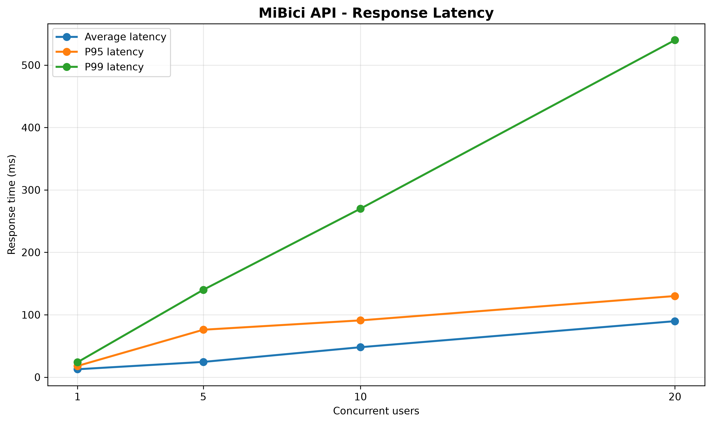
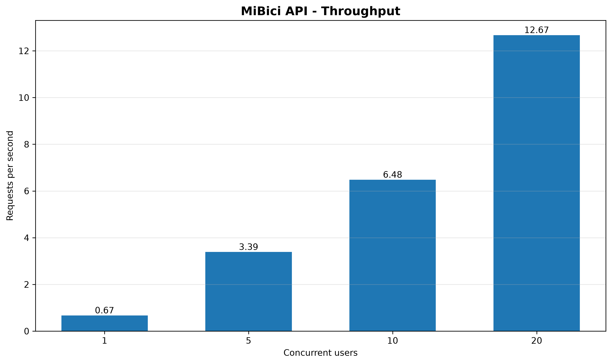
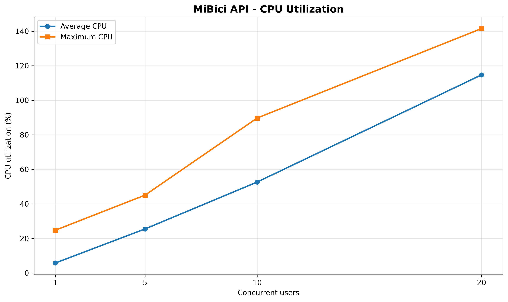
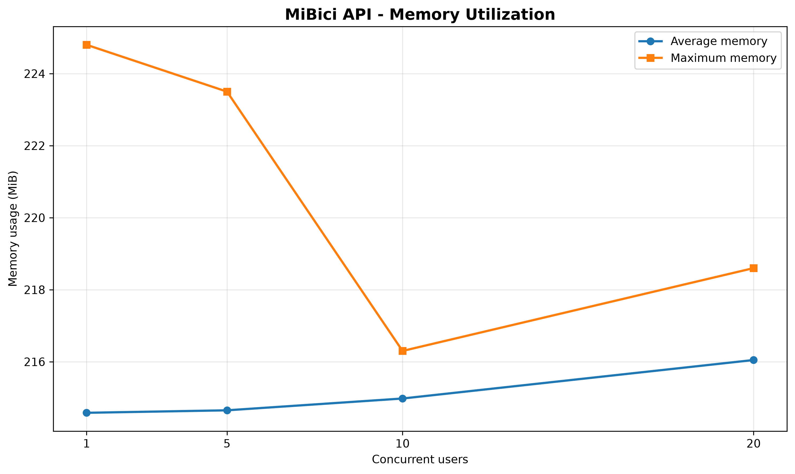
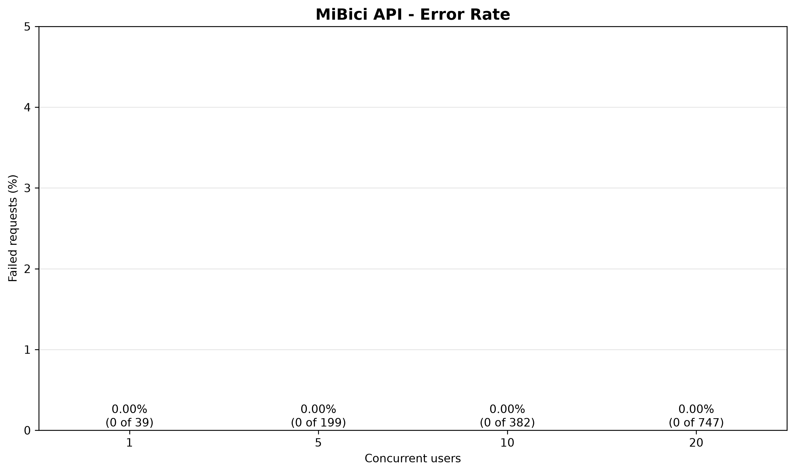
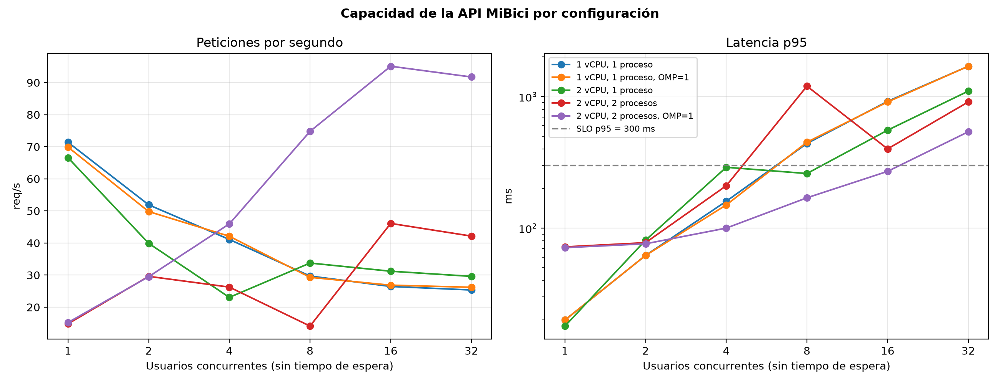

# MiBici API - Pruebas de carga y análisis de consumo de recursos

## 1. Objetivo

Evaluar el rendimiento de la API de predicción de MiBici bajo diferentes niveles de concurrencia, mediante pruebas de carga y monitoreo de los recursos computacionales utilizados por el contenedor.

El objetivo es caracterizar el comportamiento del servicio en términos de latencia, capacidad de procesamiento (*throughput*), utilización de CPU y consumo de memoria, identificando posibles limitaciones operativas y oportunidades de optimización.

Para ello, se utilizó Locust para simular solicitudes concurrentes y las estadísticas de Docker para monitorear el consumo de recursos del contenedor durante cada experimento.

## 2. Entorno de pruebas

| Componente | Configuración |
|---|---|
| Framework de la API | FastAPI |
| Gestión de modelos | MLflow / Scikit-learn |
| Contenedorización | Docker |
| Herramienta de pruebas de carga | Locust 2.47.0 |
| Monitoreo de recursos | Estadísticas de contenedores Docker |
| Generación de gráficas | Matplotlib 3.11.2 |
| Endpoint evaluado | `POST /predict` |
| Contenedor | `mibici-api-baseline` |
| Entorno de ejecución | Docker Desktop / WSL2 |

La API se construyó utilizando el `Containerfile` existente. Los dos modelos registrados como *champion* en MLflow fueron exportados y empaquetados dentro de la imagen del contenedor.

Antes de iniciar los experimentos, se verificó la disponibilidad del servicio mediante el endpoint `/health`, confirmando que ambos modelos estuvieran cargados correctamente.

## 3. Metodología experimental

Se definieron cuatro escenarios para evaluar el comportamiento de la API ante diferentes niveles de concurrencia.

Cada escenario tuvo una duración aproximada de 60 segundos. Durante su ejecución, Locust generó solicitudes HTTP `POST` al endpoint `/predict`, utilizando un mismo conjunto de datos de entrada con las 15 variables requeridas por los modelos.

| Escenario | Usuarios concurrentes | Tasa de incorporación | Duración |
|---|---:|---:|---:|
| Baseline | 1 | 1 usuario/s | 60 segundos |
| Moderado | 5 | 5 usuarios/s | 60 segundos |
| Alto | 10 | 10 usuarios/s | 60 segundos |
| Estrés | 20 | 20 usuarios/s | 60 segundos |

Se recopilaron los siguientes indicadores:

- **Throughput:** cantidad de solicitudes procesadas por segundo.
- **Latencia promedio:** tiempo promedio de respuesta de la API.
- **Percentil 95 (P95):** tiempo dentro del cual se completó el 95% de las solicitudes.
- **Percentil 99 (P99):** tiempo dentro del cual se completó el 99% de las solicitudes.
- **Tasa de fallos:** proporción de solicitudes que no se procesaron correctamente.
- **Utilización de CPU:** consumo promedio y máximo de CPU del contenedor.
- **Consumo de memoria:** utilización promedio y máxima de memoria durante cada escenario.

Las mediciones de recursos se alinearon temporalmente con las ventanas de ejecución de cada experimento, evitando incluir actividad del contenedor ajena a las pruebas.

## 4. Resultados experimentales

### 4.1. Comparación general del rendimiento

La siguiente tabla presenta los resultados consolidados de Locust y del monitoreo de recursos para los cuatro escenarios evaluados.

| Indicador | Baseline | Moderado | Alto | Estrés |
|---|---:|---:|---:|---:|
| Usuarios concurrentes | 1 | 5 | 10 | 20 |
| Solicitudes totales | 39 | 199 | 382 | 747 |
| Solicitudes fallidas | 0 | 0 | 0 | 0 |
| Throughput (req/s) | 0.67 | 3.39 | 6.48 | 12.67 |
| Latencia promedio (ms) | 12.70 | 24.45 | 48.02 | 89.74 |
| Latencia P95 (ms) | 18 | 76 | 91 | 130 |
| Latencia P99 (ms) | 24 | 140 | 270 | 540 |
| CPU promedio (%) | 5.76 | 25.49 | 52.65 | 114.70 |
| Memoria promedio (MiB) | 214.58 | 214.65 | 214.98 | 216.05 |

En los cuatro escenarios no se registraron solicitudes fallidas.

### 4.2. Análisis de latencia



La latencia aumentó conforme se incrementó el número de usuarios concurrentes. El promedio pasó de 12.70 ms en el escenario inicial a 89.74 ms durante la prueba de estrés.

El percentil 99 alcanzó los 540 ms con 20 usuarios concurrentes, lo que evidencia una mayor variabilidad en los tiempos de respuesta bajo cargas elevadas.

Este comportamiento sugiere un incremento en la contención de recursos de procesamiento conforme aumenta la concurrencia.

### 4.3. Análisis de throughput



La capacidad de procesamiento aumentó progresivamente, alcanzando 12.67 solicitudes por segundo en el escenario de estrés.

La API mantuvo el procesamiento de las solicitudes sin fallos registrados durante los experimentos. Sin embargo, el incremento del throughput estuvo acompañado de mayores tiempos de respuesta.

Esto muestra que una mayor cantidad de solicitudes procesadas simultáneamente no implica necesariamente mantener los mismos niveles de latencia.

### 4.4. Análisis de utilización de CPU



El consumo promedio de CPU aumentó de 5.76% en el escenario inicial a 114.70% durante la prueba de estrés.

Este incremento indica que la demanda de procesamiento representa un factor importante en el comportamiento de la API cuando aumenta la concurrencia.

Los valores superiores al 100% son posibles porque Docker reporta el consumo de CPU considerando la utilización de múltiples núcleos.

### 4.5. Análisis de consumo de memoria



El consumo promedio de memoria se mantuvo relativamente estable en los cuatro escenarios, con valores entre 214.58 MiB y 216.05 MiB.

A pesar del incremento de solicitudes concurrentes, no se observó un crecimiento significativo en el consumo de memoria durante las pruebas.

Dentro de las condiciones evaluadas, la utilización de CPU presentó una variación considerablemente mayor que el consumo de memoria.

## 5. Interpretación técnica de los resultados

Los experimentos muestran que la API puede procesar solicitudes concurrentes sin fallos registrados en los cuatro escenarios evaluados.

Se identifican tres hallazgos principales:

**1. Incremento de la demanda de procesamiento**

La utilización de CPU aumentó considerablemente conforme se incrementó la concurrencia, alcanzando un promedio de 114.70% durante el escenario de estrés. Esto indica que la capacidad de procesamiento debe considerarse al planificar incrementos en la carga de trabajo.

**2. Estabilidad en el consumo de memoria**

El consumo promedio de memoria permaneció cercano a los 215 MiB. Durante las pruebas no se identificó un crecimiento significativo asociado al incremento de solicitudes concurrentes.

**3. Mayor variabilidad en los tiempos de respuesta**

Aunque el throughput aumentó, el percentil 99 de latencia alcanzó los 540 ms durante el escenario de estrés. Esto indica que algunas solicitudes experimentaron tiempos de respuesta considerablemente mayores que el promedio.

En conjunto, los resultados sugieren que la demanda de CPU y la variabilidad de los tiempos de respuesta representan las principales consideraciones de optimización para la configuración actual.

## 6. Implicaciones desde la perspectiva de FinOps

Desde una perspectiva de FinOps, el monitoreo realizado proporciona una primera referencia para comprender los requerimientos de infraestructura asociados a la operación del servicio de predicción.

Los experimentos permiten relacionar la intensidad de la carga de trabajo con el consumo de CPU, memoria y los tiempos de respuesta de la API.

A partir de estos resultados, se identifican las siguientes oportunidades de optimización:

- Evaluar la asignación de CPU y los límites de recursos del contenedor.
- Analizar el impacto de incorporar trabajadores adicionales (*API workers*).
- Investigar el costo computacional de la inferencia de los modelos.
- Comparar el consumo de recursos respecto al throughput obtenido al evaluar distintas configuraciones de despliegue.
- Estimar los costos de infraestructura utilizando precios reales del proveedor de nube o alojamiento una vez definido el entorno de producción.

Es importante distinguir entre consumo de recursos y costo monetario de operación. Los experimentos de esta sección midieron la utilización local de CPU y memoria; el costo por inferencia con precios reales de AWS se calcula en el [análisis FinOps](../../reports/finops/finops_report.md), a partir de la prueba de capacidad de la sección 10.

## 7. Limitaciones del experimento

Los resultados deben interpretarse considerando las características del entorno experimental:

- Las pruebas se realizaron localmente mediante Docker Desktop y WSL2.
- Se evaluó un único endpoint de predicción.
- Cada escenario tuvo una duración aproximada de 60 segundos.
- Se utilizó una sola configuración del contenedor y una misma versión de los modelos exportados.
- No se evaluaron condiciones de red de producción ni generación distribuida de carga.
- No se estableció la capacidad máxima de producción ni el costo monetario de infraestructura. Ambos se atienden en la sección 10 y en el [análisis FinOps](../../reports/finops/finops_report.md).

La ejecución de pruebas adicionales con periodos más prolongados, múltiples repeticiones y diferentes configuraciones de despliegue permitiría obtener evidencia más robusta para la planificación de capacidad.

## 8. Reproducibilidad

### 8.1. Instalación de dependencias

Desde la raíz del repositorio:

```bash
pip install -r requirements-load.txt
```

### 8.2. Construcción y ejecución de la API

Construir la imagen:

```bash
docker build -t mibici-api:integrante3 -f Containerfile .
```

Iniciar el contenedor:

```bash
docker run -d \
  --name mibici-api-baseline \
  -p 127.0.0.1:8000:8000 \
  mibici-api:integrante3
```

Verificar disponibilidad:

```bash
curl http://127.0.0.1:8000/health
```

La respuesta esperada debe confirmar el estado saludable del servicio y la carga de ambos modelos.

### 8.3. Monitoreo de recursos del contenedor

El consumo de recursos se registró mediante el script `monitor_resources.py`, que consulta las estadísticas del contenedor utilizando `docker stats --no-stream`.

El monitoreo registra las siguientes variables:

| Variable | Descripción |
|---|---|
| `timestamp_utc` | Fecha y hora de la medición en UTC. |
| `container` | Nombre del contenedor monitoreado. |
| `cpu_percent` | Porcentaje de utilización de CPU. |
| `memory_usage` | Memoria utilizada y límite disponible. |
| `memory_limit` | Límite de memoria del contenedor. |
| `memory_percent` | Porcentaje de utilización de memoria. |
| `network_io` | Datos recibidos y transmitidos por la red. |
| `block_io` | Operaciones de lectura y escritura en bloques. |
| `pids` | Número de procesos del contenedor. |

El intervalo de muestreo predeterminado es de un segundo. Cada medición se almacena inmediatamente en un archivo CSV, utilizando marcas de tiempo UTC para facilitar su correlación con los resultados de Locust.

Para iniciar el monitoreo del escenario Baseline:

```bash
python tests/load/monitor_resources.py \
  --container mibici-api-baseline \
  --interval 1 \
  --output tests/load/results/baseline_1user_resources.csv
```

Para los escenarios restantes, se utiliza el mismo procedimiento, modificando el nombre del archivo de salida:

```bash
# Escenario moderado
python tests/load/monitor_resources.py \
  --container mibici-api-baseline \
  --interval 1 \
  --output tests/load/results/moderate_5users_resources.csv

# Escenario alto
python tests/load/monitor_resources.py \
  --container mibici-api-baseline \
  --interval 1 \
  --output tests/load/results/high_10users_resources.csv

# Escenario de estrés
python tests/load/monitor_resources.py \
  --container mibici-api-baseline \
  --interval 1 \
  --output tests/load/results/stress_20users_resources.csv
```

El monitoreo debe permanecer activo durante la ejecución de cada prueba de carga y detenerse mediante `Ctrl+C` al finalizar el experimento. También se detiene limpiamente con `kill` (SIGTERM), lo que permite automatizarlo desde scripts.

Las mediciones recopiladas se utilizan posteriormente para calcular estadísticas de consumo promedio, mínimo y máximo, considerando únicamente la ventana temporal correspondiente a cada escenario.

Con Docker Compose el contenedor no tiene nombre fijo; se pasa su ID:

```bash
python tests/load/monitor_resources.py \
  --container "$(docker compose ps -q api)" \
  --output tests/load/results/<archivo-nuevo>_resources.csv
```

Con Podman se agrega `--engine podman`. Con `--no-stream`, Podman reporta el CPU promedio desde que arrancó el contenedor y no el del último intervalo, por lo que el script calcula el porcentaje a partir de la diferencia del tiempo de CPU acumulado (`CPUNano`) entre dos muestras consecutivas. Sin ese ajuste, un contenedor que pasó horas inactivo reporta menos del 3 % de CPU aunque esté saturado.

### 8.4. Ejecución de las pruebas con Locust

Con la API disponible en `http://127.0.0.1:8000` y el monitoreo activo en otra terminal, cada escenario se ejecuta en modo *headless* durante 60 segundos. `-u` fija los usuarios concurrentes y `-r` la tasa de incorporación (igual a `-u`, para que todos inicien en el primer segundo). `--csv` genera los archivos `<prefijo>_stats.csv`, `<prefijo>_stats_history.csv`, `<prefijo>_failures.csv` y `<prefijo>_exceptions.csv`:

```bash
# Baseline
locust -f tests/load/locustfile.py --headless --host http://127.0.0.1:8000 \
  -u 1 -r 1 -t 60s --csv tests/load/results/baseline_1user --only-summary

# Moderado
locust -f tests/load/locustfile.py --headless --host http://127.0.0.1:8000 \
  -u 5 -r 5 -t 60s --csv tests/load/results/moderate_5users --only-summary

# Alto
locust -f tests/load/locustfile.py --headless --host http://127.0.0.1:8000 \
  -u 10 -r 10 -t 60s --csv tests/load/results/high_10users --only-summary

# Estrés
locust -f tests/load/locustfile.py --headless --host http://127.0.0.1:8000 \
  -u 20 -r 20 -t 60s --csv tests/load/results/stress_20users --only-summary
```

Cada usuario espera entre 1 y 2 segundos entre peticiones (`wait_time = between(1, 2)`), como lo haría una persona consultando la app. Por eso el throughput crece casi en proporción a los usuarios: lo limita el tiempo de espera del cliente y no la API. Para medir la capacidad máxima se usa la prueba de capacidad de la sección 10.

Para no sobrescribir la evidencia original, usar prefijos nuevos al repetir los escenarios.

### 8.5. Análisis de consumo de recursos

Una vez recopiladas las estadísticas de Locust y las mediciones del contenedor, se utiliza `analyze_resources.py` para analizar el consumo de infraestructura durante cada escenario.

El script recibe dos archivos CSV:

- `--history`: historial de ejecución de Locust, utilizado para identificar el inicio y final del experimento.
- `--resources`: mediciones de recursos recopiladas mediante `monitor_resources.py`.

La metodología de análisis comprende los siguientes pasos:

1. Lectura de los archivos CSV correspondientes al experimento.
2. Identificación de los registros agregados de Locust para determinar la ventana temporal de ejecución.
3. Conversión de las marcas de tiempo a valores comparables en UTC.
4. Filtrado de las muestras de recursos para conservar únicamente aquellas comprendidas dentro de la ventana del experimento.
5. Conversión de las unidades de memoria a MiB para mantener una escala uniforme.
6. Cálculo de los valores promedio, mínimo y máximo de utilización de CPU y memoria.

De esta manera, las estadísticas de infraestructura representan el comportamiento del contenedor durante la prueba de carga y no durante periodos ajenos al experimento.

**Ejemplo de ejecución:**

```bash
python tests/load/analyze_resources.py \
  --history tests/load/results/baseline_1user_stats_history.csv \
  --resources tests/load/results/baseline_1user_resources.csv
```

Para los demás escenarios, se sustituyen los archivos de entrada correspondientes:

| Escenario | Archivo de historial | Archivo de recursos |
|---|---|---|
| Baseline | `baseline_1user_stats_history.csv` | `baseline_1user_resources.csv` |
| Moderado | `moderate_5users_stats_history.csv` | `moderate_5users_resources.csv` |
| Alto | `high_10users_stats_history.csv` | `high_10users_resources.csv` |
| Estrés | `stress_20users_stats_history.csv` | `stress_20users_resources.csv` |

El resultado proporciona estadísticas de consumo promedio, mínimo y máximo para cada escenario, que posteriormente se utilizan en la comparación y visualización del rendimiento de la API.

### 8.6. Generación de gráficas

```bash
python tests/load/plot_results.py
```

Lee los CSV de los cuatro escenarios, alinea las muestras de recursos con la ventana de cada prueba y genera en `tests/load/results/graphs/` las gráficas de latencia, throughput, CPU, memoria y tasa de error, además de `benchmark_summary.csv`.



Ninguna de las 1,367 peticiones de los cuatro escenarios falló (0 % de errores en todos).

## 9. Estructura de los entregables

Los scripts y evidencias experimentales se organizan de la siguiente manera:

```text
tests/load/
├── locustfile.py            # Escenarios con usuarios que esperan 1-2 s
├── locustfile_capacity.py   # Prueba de capacidad: usuarios sin espera, por escalones
├── monitor_resources.py     # docker/podman stats a CSV
├── analyze_resources.py
├── plot_results.py
└── results/
    ├── baseline_1user_*.csv
    ├── moderate_5users_*.csv
    ├── high_10users_*.csv
    ├── stress_20users_*.csv
    ├── capacity/            # Pruebas de capacidad por configuración (sección 10)
    └── graphs/
        ├── 01_response_latency.png
        ├── 02_throughput.png
        ├── 03_cpu_utilization.png
        ├── 04_memory_utilization.png
        ├── 05_error_rate.png
        └── benchmark_summary.csv
```

Los archivos CSV conservan las mediciones experimentales originales, mientras que las gráficas permiten comparar visualmente el rendimiento de la API y el consumo de recursos bajo diferentes niveles de concurrencia.

## 10. Prueba de capacidad (Entregable 7)

Los escenarios anteriores no saturan la API: el tiempo de espera de los usuarios limita el throughput. Para el análisis FinOps se necesita la capacidad máxima sostenible, así que se agregó `locustfile_capacity.py`. Reutiliza la petición y las validaciones de `locustfile.py`, pero sus usuarios no esperan entre peticiones y la concurrencia sube por escalones de 1, 2, 4, 8, 16 y 32 usuarios, 30 segundos cada uno.

La prueba corre contra la API de Docker Compose, con límites de recursos fijados en `docker-compose.yml`, y monitorea a la vez la API y MLflow:

```bash
docker compose up -d --build --wait
make capacity-test CAPACITY_NAME=capacity_run
```

Sin Make, el mismo procedimiento:

```bash
python tests/load/monitor_resources.py --container "$(docker compose ps -q api)"   --output tests/load/results/capacity/capacity_run_api_resources.csv &
python tests/load/monitor_resources.py --container "$(docker compose ps -q mlflow)"   --output tests/load/results/capacity/capacity_run_mlflow_resources.csv &
locust -f tests/load/locustfile_capacity.py --headless --host http://127.0.0.1:8000   --csv tests/load/results/capacity/capacity_run --csv-full-history --only-summary
kill %1 %2
```

`CAPACITY_STEPS` (por ejemplo `1,4,16`) y `CAPACITY_STEP_SECONDS` cambian los escalones. Las configuraciones de la API se cambian con variables de entorno, sin editar archivos:

```bash
API_CPUS=2 API_MEMORY=1G API_WORKERS=2 docker compose up -d --wait api
```

### 10.1. Resultados

Cada escalón se resume con la mediana de sus últimos 20 segundos (los primeros 10 aún mezclan el escalón anterior). La capacidad sostenible es el escalón con más peticiones por segundo con p95 de 300 ms o menos y sin errores. Ninguna de las cinco pruebas registró errores.

| Configuración de la API | 1 usuario (req/s, p95) | 16 usuarios (req/s, p95) | 32 usuarios (req/s, p95) | Capacidad sostenible | Memoria API máx. |
|---|---|---|---|---|---|
| 1 vCPU, 1 proceso (valores por defecto) | 71.4, 20 ms | 26.5, 920 ms | 25.4, 1,700 ms | 71.4 req/s | 295 MiB |
| 1 vCPU, 1 proceso, `OMP_NUM_THREADS=1` | 69.9, 20 ms | 26.9, 910 ms | 26.2, 1,700 ms | 69.9 req/s | 196 MiB |
| 2 vCPU, 1 proceso | 66.6, 18 ms | 31.2, 555 ms | 29.6, 1,100 ms | 66.6 req/s | 201 MiB |
| 2 vCPU, 2 procesos | 14.8, 72 ms | 46.1, 400 ms | 42.2, 910 ms | 29.6 req/s | 413 MiB |
| 2 vCPU, 2 procesos, `OMP_NUM_THREADS=1` | 15.2, 71 ms | **95.1, 270 ms** | 91.8, 540 ms | **95.1 req/s** | 410 MiB |



### 10.2. Interpretación

- **Con un solo proceso, más concurrencia reduce el throughput.** Con 1 vCPU, la API atiende 71 req/s con un usuario y solo 25 req/s con 32, mientras la latencia p95 pasa de 20 ms a 1.7 s. El endpoint `/predict` es síncrono: FastAPI lo ejecuta en un pool de hasta 40 hilos que compiten por el GIL de Python dentro del mismo proceso.
- **Duplicar la CPU de un solo proceso no ayuda.** Con 2 vCPU la API consume más CPU (171 % en promedio) pero su throughput con concurrencia apenas cambia. Más núcleos solo sirven con más procesos.
- **Los procesos necesitan `OMP_NUM_THREADS=1`.** Los modelos son `HistGradientBoostingClassifier`, que usa OpenMP con un hilo por núcleo que *ve* el contenedor (los 8 del host, no los 2 asignados). Con un proceso eso no afecta, pero con dos los hilos compiten por los 2 vCPU y el resultado es errático. Con un hilo por proceso, la API sostiene 95 req/s con 16 usuarios: 3.6 veces más que la configuración por defecto, con p95 de 270 ms contra 920 ms.
- **Costo de la optimización.** Con un solo usuario la latencia sube de unos 20 ms a unos 70 ms con dos procesos; sigue dentro del SLO.
- **MLflow consume 1.8 GiB de memoria y menos del 3 % de CPU** durante todas las pruebas: pesa más que la API en memoria sin participar en la inferencia.

Por eso `docker-compose.yml` fija `OMP_NUM_THREADS=1` y expone `API_WORKERS`. Los valores por defecto (1 vCPU, 1 proceso) se conservan para que API y MLflow quepan juntos en una instancia de 2 vCPU y 4 GiB. El costo de cada configuración en AWS está en el [análisis FinOps](../../reports/finops/finops_report.md).

Entorno: Docker Desktop 29.4.1 en Linux, AMD Ryzen 7 3700U (8 hilos), máquina virtual de Docker con 8 vCPU y 7.1 GiB. Las cifras sirven para comparar configuraciones en el mismo equipo; un vCPU de AWS puede rendir distinto.
